# Visual Office — architecture and diagram set

**26 October source reconciliation:** current main source is `949736446824d4803f9109a20830202494abd7b7`. The legacy CRM/Marketing dashboard and sidebar were removed from the app; the current shared workspace header/dock remains for workspace routes and is hidden while an Office route is active. `BuildingView` remains the ordinary path with a pinned 14-floor presentation map; GLB rendering is selected only by an eligible locally saved `tycoon3d` edition. The explicit synthetic dynamic-context candidate uses `TycoonDomainView` + `OfficeArtScene` and reuses the canonical campus/Lobby/painted HybridScene art. See §§2–5 for current routing and ownership. Older dated design and canon audits below remain provenance where labeled; they do not establish live Zuri acceptance or production deployment.

เอกสารนี้เป็น system view ของ Visual Office และเส้นแบ่งกับ Zuri; diagram ทุกภาพแยก
**ของที่รันอยู่ใน repository ปัจจุบัน** ออกจาก **target ที่ยังต้องมี platform contract**
อ้างข้อกำหนดหลักใน [VISUAL-OFFICE-SRS.md](VISUAL-OFFICE-SRS.md) และหน้าจอใน
[OFFICE-UX-FLOWS.md](OFFICE-UX-FLOWS.md)

## 1. Viewpoint และสถานะ

| View | คำถามที่ตอบ | สถานะ |
| --- | --- | --- |
| System context | ใครใช้ Office และข้อมูลมาจากไหน | Current renderer modes + synthetic/target boundary |
| Container/component | Browser app ประกอบด้วยอะไรและใครถือ state | Source `9497364`; route-mode split |
| Domain-to-floor projection | domain key กลายเป็นชั้นอย่างไร | Default pinned presentation + separate candidate context |
| Read sequence | เลือก Business แล้วอ่าน floor ผ่าน proxy อย่างไร | Synthetic candidate sequence; dev connector separate |
| Canonical write sequence | CRUD/Agent command และ event ควรเกิดอย่างไร | Target proposal; ไม่มี implementation/contract ยืนยัน |
| Scene state model/lifecycle | room/floor/asset reference ถูก save/export อย่างไร | Local editor contract ปัจจุบัน |
| Deployment topology | local proxy, Worker handler code and platform-hosted boundary ต่างกันอย่างไร | Local plumbing + Worker source + hosted target; no production evidence |
| Asset build pipeline | source, GLB, manifest และ browser catalog เชื่อมกันอย่างไร | Local bundle pipeline |

## 2. System context

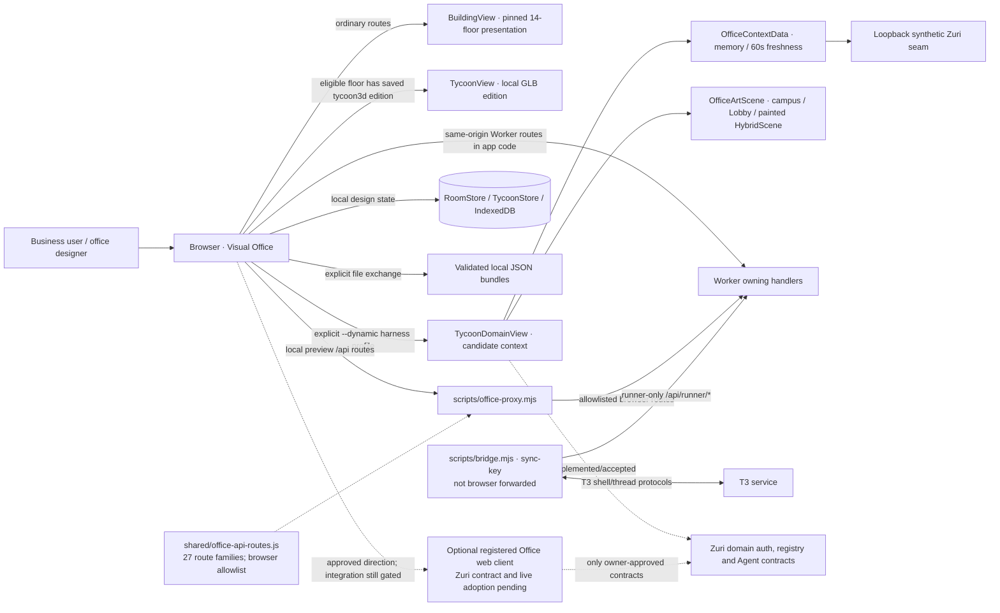

Solid edges describe current local plumbing and the same-origin Worker route shape
defined in source; they do not establish production deployment. The dynamic candidate
edge ends at a synthetic loopback seam and is not live Zuri authorization.
The pinned `BuildingView` projection, an explicitly saved local GLB edition and the
synthetic candidate are distinct route modes. Scene stores and JSON files are local
presentation state. T3 bridge/queue traffic is separate from Zuri domain APIs and the
browser proxy does not forward `/api/runner/*`.

## 3. Browser containers and component ownership

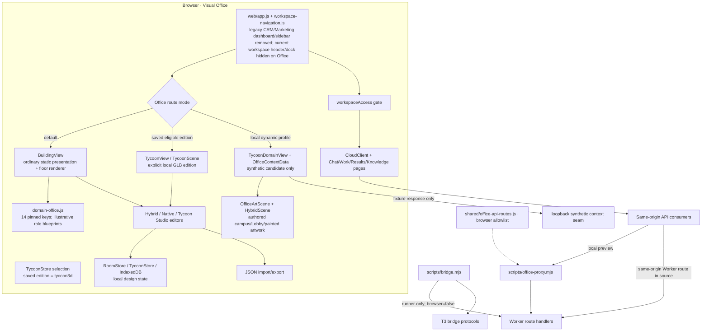

**Ownership rules:** `domain-office.js` owns only the static presentation map and
role examples. Dynamic directory rows come from a validated candidate context; they
do not authenticate a real Business or contain a roster. `OfficeArtScene` owns the
candidate visual adapter and reuses the existing campus/Lobby and painted
HybridScene art; it creates no Agent actor. `TycoonStore`, `RoomStore`, and local
custom-asset storage own visual drafts, not Business configuration. `workspaceAccess`
gates workspace pages separately. T3 bridge/queue routes and data remain separate
from Zuri domain authority.

## 4. Domain-to-floor projection

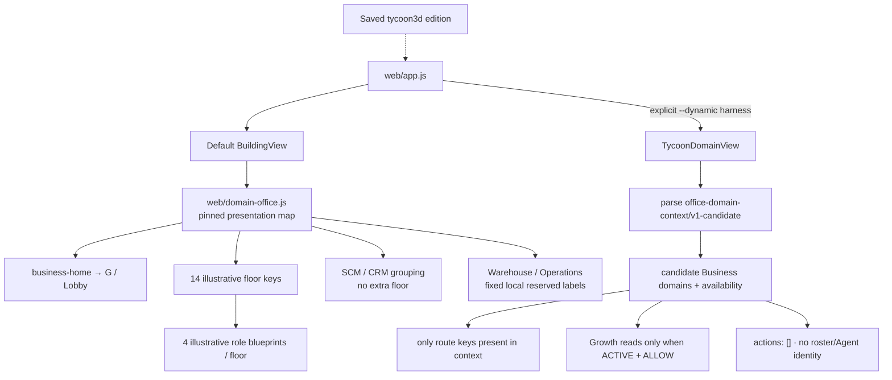

Default `domain-office.js` pins the 14 floor keys to a historical Zuri source
revision (`30911f98e12d535133e77dbe3c3bd42ed6ee9864`). The original canon-parity
comparison to Zuri `origin/main` `18008b774fc54febd23ca675d142f15da7d67db5` is a
frozen audit snapshot, not proof of current per-Business visibility. Static role
blueprints are illustrative. The dynamic candidate does not use this static map to
grant access: `office-domain-context.js` validates candidate rows, selected Business,
revisions, freshness, availability and operation hints. Only the two supported
Growth read operations can pass `contextAllows`; candidate `actions` must be empty.
Neither path is an approved Zuri Agent roster. A locally saved GLB edition is a
separate presentation choice, not a domain grant.

## 5. Current domain read sequence — synthetic candidate

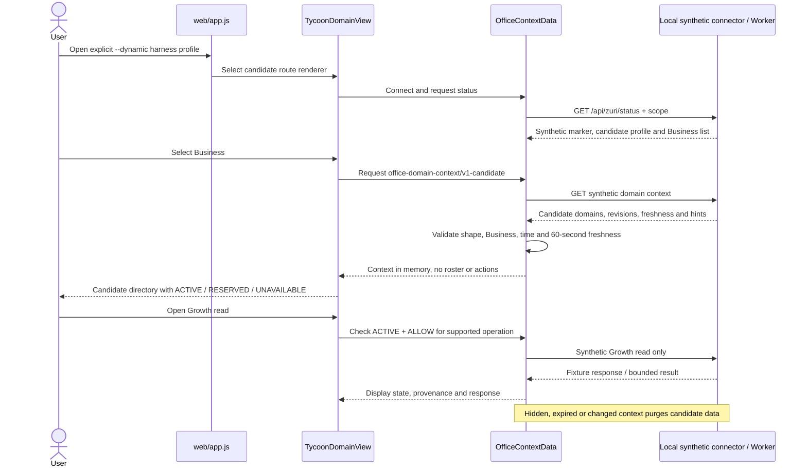

This is an isolated synthetic candidate flow, not an authenticated Zuri API sequence.
It grants no live access, roster, action or scene save. The opt-in development
`ZuriPanel` connector is a separate adapter; see [API-ENDPOINT-AUDIT.md](API-ENDPOINT-AUDIT.md) for its
current route inventory and limits. The same audit records 27 shared Office route
families, browser-only proxy admission, and runner route exclusion. A 404/405 policy
check or synthetic response does not prove platform authorization or live acceptance.

## 6. Target canonical write and post-commit event sequence

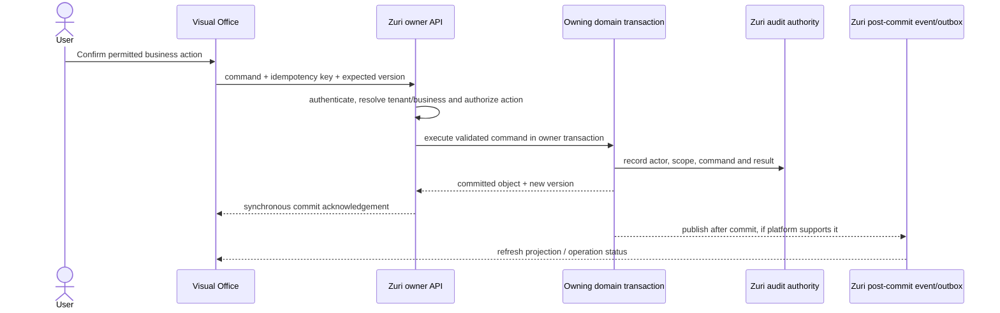

**Target only.** Visual Office currently has no generic authenticated department Agent
dispatch, canonical CRUD adapter, version conflict reconciliation or shared event bus.
Reuse only an approved platform contract; if Zuri does not provide an operation, hide
that action. A long-running Agent run needs its own durable operation/receipt contract.

## 7. Scene state model and persistence lifecycle

Full code-derived storage and entity inventory: [DATA-MODEL.md](DATA-MODEL.md).

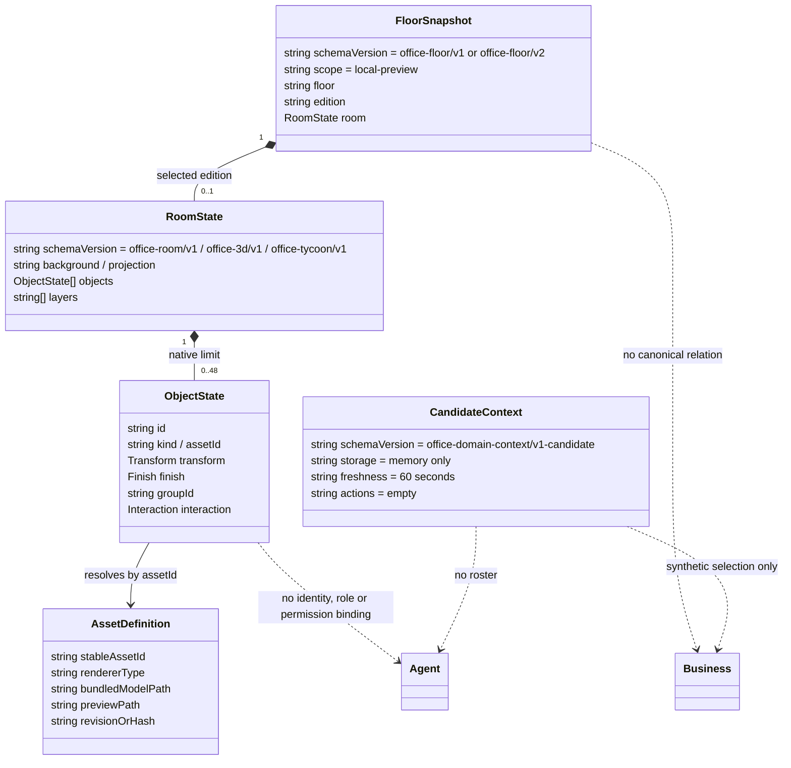

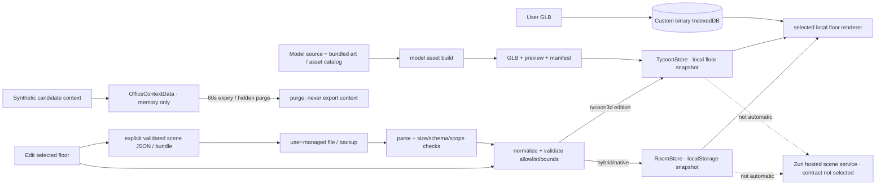

Hybrid/Native `RoomStore` and `TycoonStore` hold browser-local design snapshots under
their respective formats; a saved `tycoon3d` edition is an explicit local renderer
selection, not the standard route default. Custom GLB bytes use a separate IndexedDB
store. `OfficeContextData` holds only the synthetic candidate context in memory and
purges it at expiry or when hidden/context changes; it is never part of a floor file.
Bundled art, static models, local drafts and T3 workspace records are different owners.
Save does not compile or deploy a model. File export/import is explicit. There is no
shared scene database, client-side WAL or cross-tab transaction.

## 8. Deployment topology

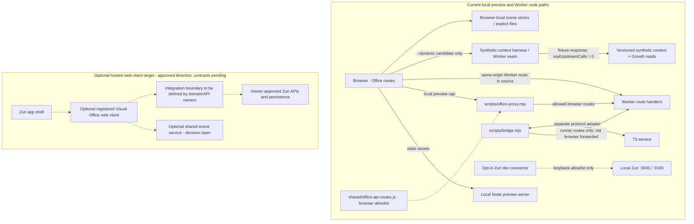

The local dynamic harness uses the selected synthetic candidate fixture and never
calls a real upstream; `--workspace` is a separate isolated in-memory Worker profile.
The opt-in Zuri development connector is constrained to documented loopback targets
and does not make the candidate profile a live contract. Office routes hide the current
shared workspace header/dock; workspace pages are separately controlled by
`workspaceAccess`. Preview mode in [`scripts/serve.mjs`](../scripts/serve.mjs) disables
the separate T3/Sites credential bridge. None of these paths establishes production
SSO, service registration, hosted asset storage or cross-device state. A platform
deployment design must be updated after Zuri publishes its actual service/auth/host
contract.

## 9. Model asset and Office art paths

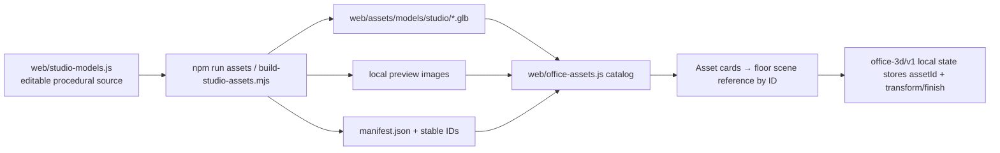

This local pipeline packages GLBs into the app; it is not an asset management service.
Each future remote asset store needs explicit immutable revision/hash, access control,
preview metadata, compatibility, retention and delivery strategy before adoption.

The regular campus and Lobby routes also use the existing `idle-campus` and Lobby
art assets. `OfficeArtScene` composes those images with keyboard-operable hotspots and
uses `HybridScene` with `paintedArt: true` for candidate floors. Campus Fit uses
`framing: 'cover'` with `overscan: 1.25`; floor Fit retains the shared whole-scene
`contain` framing. The candidate art path is not the GLB prototype. This behavior is
covered by `tests/office-art-scene.test.mjs`; that test is synthetic/source evidence,
not rendered user acceptance.

## 10. Diagram and document coverage register

| Concern | Source diagram/document | Coverage |
| --- | --- | --- |
| Current renderer modes and low-fidelity screen wireframes | `OFFICE-UX-FLOWS.md` §§2–6 | Default, saved GLB edition and synthetic candidate are distinct; tables, not pixel mockups |
| Navigation wireflow | `OFFICE-UX-FLOWS.md` Mermaid flowchart | Present |
| Manager user flow | `OFFICE-UX-FLOWS.md` user flow 1 | Present; platform branch clearly marked target |
| Designer user flow | `OFFICE-UX-FLOWS.md` user flow 2 | Present |
| System context | This document §2 | Added |
| Container/component ownership | This document §3 | Added |
| Domain → floor mapping and Agent mismatch | This document §4 | Added |
| Synthetic candidate read sequence | This document §5 | Added; fixture-only, no live Zuri contract |
| API route/proxy/bridge inventory | `API-ENDPOINT-AUDIT.md` | 27 route families; owning handlers retain auth/payload rules |
| Write/event sequence | This document §6 | Added; target proposal only |
| Scene data model/state lifecycle | This document §7 | Added; local schemas, no ERD because no Visual Office DB |
| Deployment topology | This document §8 | Added; current vs target clearly separated |
| Asset build pipeline | This document §9 | Added |
| Zuri external schema/API contract | Platform must publish it | **Not present in Visual Office; deliberately not invented** |
| Database ERD for canonical data | Zuri owns its models/database | **Not a Visual Office database; use Zuri's approved source** |

## 11. Change rules

1. Update the SRS requirement/status and the owning component document together when a
   user-visible behavior changes.
2. Reconcile `web/domain-office.js` against a named Zuri revision whenever the registry
   changes; record operational domains separately from shell/group entries.
3. Never promote four local role blueprints, T3 personas, or generic avatar assets to
   canonical Zuri Agent roles without an approved roster contract.
4. Label target sequence/deployment arrows as proposals until code, contract tests and
   authorized runtime evidence exist.
5. Do not draw an ERD for platform-owned records by inferring models from UI labels;
   reference Zuri's canonical model/contract instead.

## Three.js room and navigation authoring refinement (23 October)

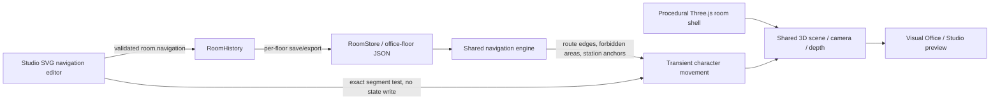

The Office shell, props and actors share ground transforms. Authored routes/areas/stations are presentation state; tenant, Business and Agent authority is unchanged. Structural JSON validation and physical walk-test success are separate acceptance checks. The procedural model does not create a durable shared scene service or a new GLB asset catalog admission.

## Measured blueprint authoring (23 October)

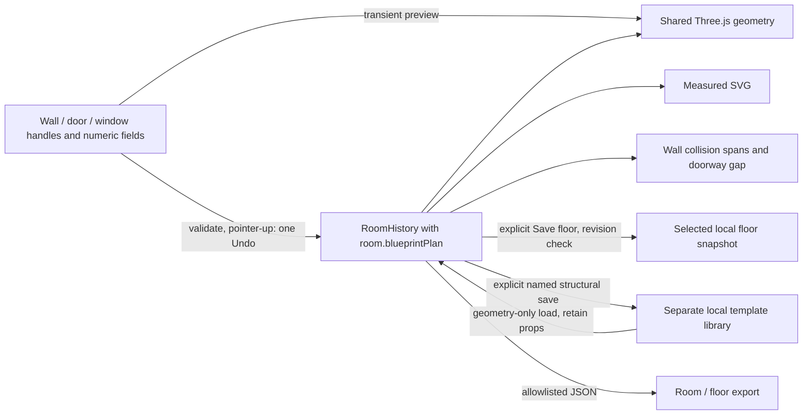

Plan validation owns metric bounds, wall-bound non-overlapping openings and the fixed-camera envelope. The geometry signature controls shell reconstruction/disposal. Furniture models and their authored transforms survive the rebuild. Named structural templates contain no furniture or platform identity; ordinary floor snapshots retain the full scene. Library storage and floor storage are browser-local, not a shared backend. Details and acceptance limits: [Office blueprints](OFFICE-BLUEPRINTS.md).

Interior partitions and typed room labels extend that same plan; they do not create another persistence owner:

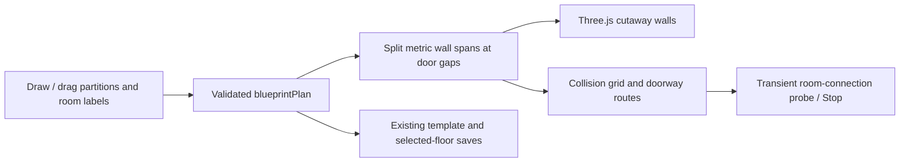

Saved route points remain unchanged; blocked route edges can use local A* detours for partitioned rooms. Forbidden areas, furniture and blocked endpoints still constrain movement. Area labels classify use and colour floor patches; only physical spans determine room connectivity.

Door state uses the same blueprint resource (`door.open` / `partitions[].door.open`, omitted = open). Scene click → occupied-threshold guard → Studio history or revision-checked local floor save → shared layout → visible panels and closed-door collision blockers. Movement revalidates next segments; no asynchronous door event grants walking permission. Read-only previews have disabled toggles. `office-door-save.js` reads the current floor revision before writing, retaining the previous scene on conflicts/write failure. No business or Agent state is written.

## Tycoon local structure/navigation adapter — 24 October

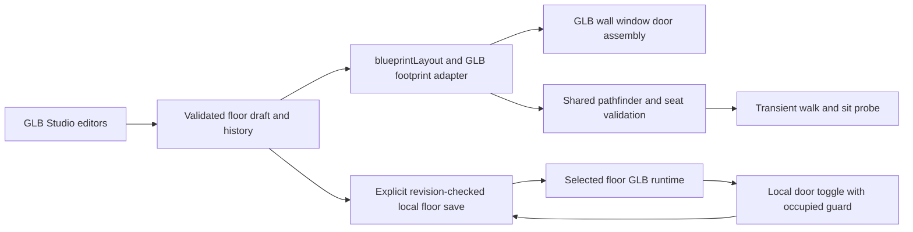

`office-tycoon/v1` accepts optional `blueprintPlan` and `navigation`; these reference only local
geometry. The existing `office-floor/v2` envelope carries them without Agent or Business bindings.
Studio's transient previews and probes never write storage. Named templates store structure only;
floor saves store the validated entire room. Legacy stores are untouched. See
[GLB adapter details](OFFICE-BLUEPRINTS.md#glb-studio-adapter--24-october-2026) for coordinate
translation, unsupported old sizes, collision margins, seat matching and runtime save recovery.
This local adapter does not supply shared persistence, cross-device synchronization or Zuri APIs.

### Local GLB selection and finish state

Tycoon rooms optionally store object `groupId`/`finish` and room `layers`/`finishes`.
Selection and drag previews are transient; validated group transforms commit one draft history
entry and only Save writes the selected floor. Layers are an exact inventory permutation.
Textures are normalized embedded PNGs, bounded by both image and UTF-8 scene limits.
Materials are instance-owned; stable canvas allocations avoid async texture resize failures.
Source GLB caches own their original geometry/material/texture lifetime. No agent roster or
business role is part of this editable inventory.

### Reusable local furniture assets

The GLB personal library stores validated relative furniture sets in independent per-entry
browser keys. Set capture resolves default or authored seat anchors, snapshots visual metadata,
and renders a PNG preview. Insertion remaps object/group/station references into the selected
floor draft; it cannot modify another floor or any Agent identity. No library entry carries
room shell/navigation or business bindings. The existing floor save boundary remains unchanged.

Portable `office-furniture-bundle/v1` files embed the set and deduplicated GLB binaries.
The codec validates an 8 MB bound, strict shape, installed kit revision/geometry fingerprint,
GLB headers and SHA-256 before library persistence. The receiving renderer uses verified
byte-identical installed models; arbitrary kit installation is outside this format. File export
is a user-managed backup/transfer mechanism, not shared platform persistence.

### User-owned GLB props

The custom-model extension adds an IndexedDB binary store alongside existing card/floor
metadata. Content hashes identify immutable embedded GLBs; each placed object snapshots name,
category, normalization/dimensions and local interaction configuration. Runtime and thumbnail
loaders verify the binary and measurement before rendering. Actual dimensions drive collision.

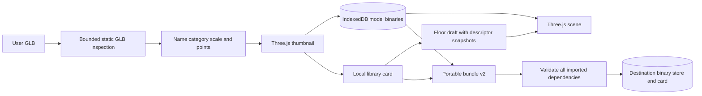

Bundle v2 transfers arbitrary supported static custom GLBs, while v1 remains restricted to
the installed kit. Neither is shared platform storage or a permission to dispatch business work.
See OFFICE-BLUEPRINTS for budgets, lifecycle, floor-file dependencies and supported interactions.

## 12. Current source and verification boundary — 26 October 2026

The route and component views above are reconciled to main source revision
`949736446824d4803f9109a20830202494abd7b7`. CI run `40326980103` reports 747 tests,
a build containing 412 embedded assets, and the compatibility check `PASS`. These
results establish repository CI only. The local candidate fixtures do not qualify
Zuri authentication, domain authorization, live Agent rosters or commands, production
deployment, shared scene persistence, or user/device acceptance.

The 27 route families and retained server-side T3 bridge are detailed in
[API-ENDPOINT-AUDIT.md](API-ENDPOINT-AUDIT.md). Live platform contracts and shared
scene persistence remain unselected. `tests/office-art-scene.test.mjs` covers source
behavior for campus overscan, floor Fit and painted candidate art; it is not a
substitute for rendered visual or live integration acceptance.
