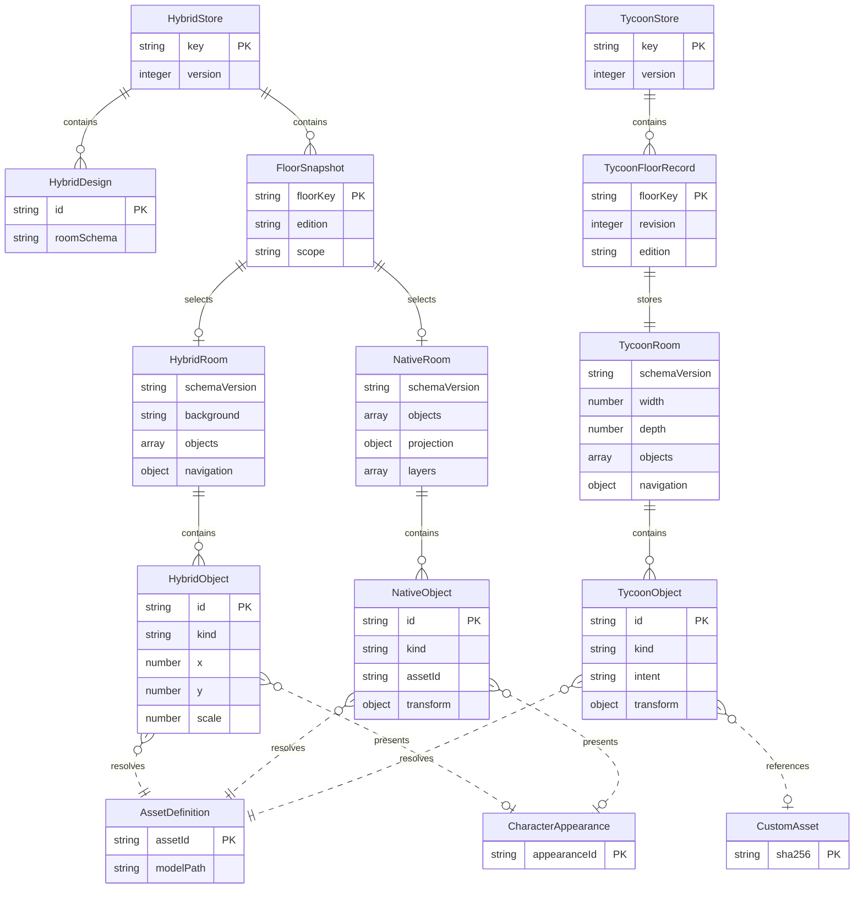
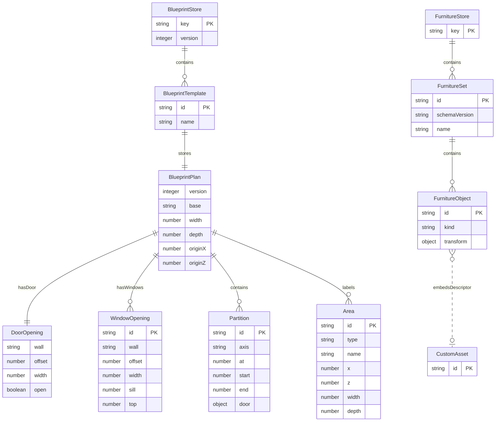
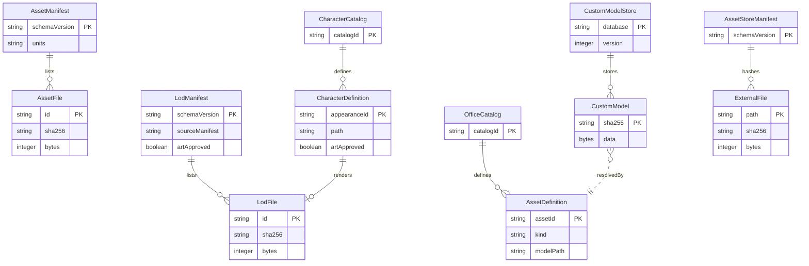
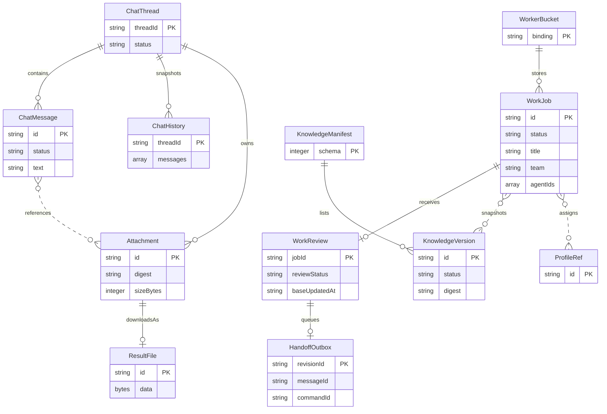
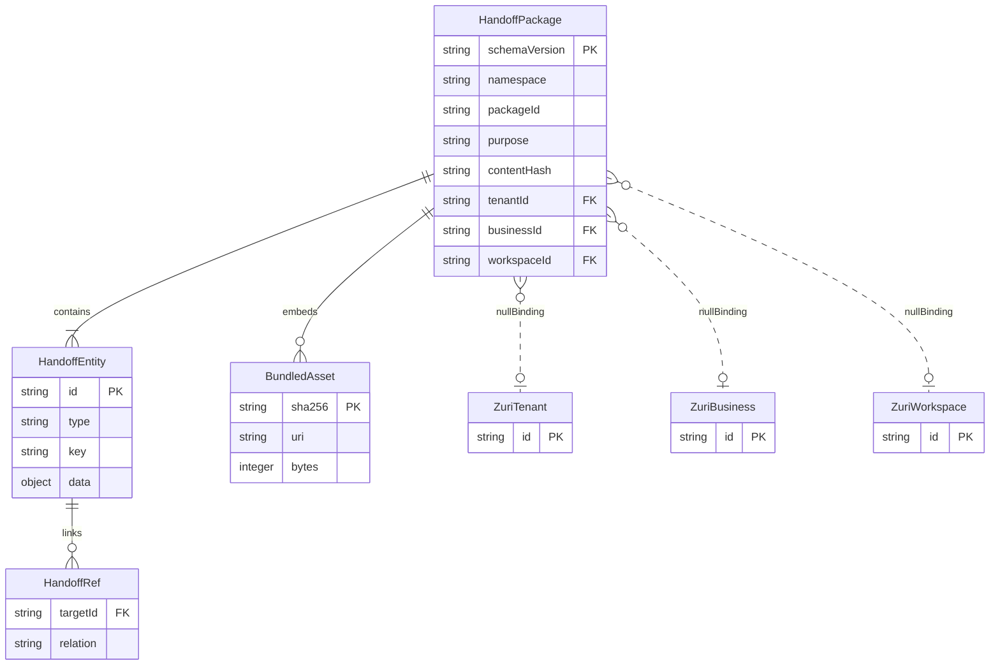
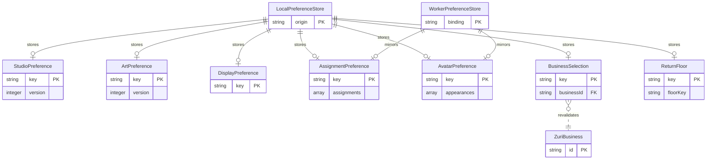

# Visual Office code-derived data model

This document records persisted and exchanged shapes found in the current source tree. It is a code inventory, not an additional requirements registry or a proposal for a Zuri schema. A store described here is not evidence that it is enabled in a particular deployment. File and function links identify the implementation; tests pin selected behavior but do not establish production acceptance.

**Coverage:** browser persistence, Worker R2 objects, source and generated metadata, and supported downloads. Volatile UI state, runtime caches, in-memory histories, request bodies that are not persisted, and third-party service internals are excluded except where needed to explain a persisted relation. For requirement status and system diagrams see [the SRS](VISUAL-OFFICE-SRS.md) and [architecture §7](ARCHITECTURE.md#7-scene-state-model-and-persistence-lifecycle).

## 1. Scope and ownership

Visual Office owns local scene/design drafts, presentation preferences, its bundled or user-imported visual assets, versioned file exchange, and the records written by its Worker handlers to the configured R2 bucket. Local scene IDs, floor keys, role labels, avatar appearances, and handoff design IDs are Office-side presentation/design identities.

Zuri owns Tenant, Business, Workspace, domain authorization, canonical Agent identities/roles/permissions, and canonical work records. Visual Office may hold or display a reference or a bounded read projection after an authorized API read. It does not define those records here, create authority from scene furniture, or treat a proposal/export as a Zuri write. This is the G5 boundary in [the integration boundary](ZURI-PLATFORM-INTEGRATION-BOUNDARY.md) and [the SRS](VISUAL-OFFICE-SRS.md).

Worker jobs under office/jobs are Visual Office task-runner records. They are not asserted to be Zuri WorkItems. Chat histories, attachments, knowledge versions and review records are likewise Worker-held Office data. The office/preferences.json record is Worker-held preference data; it is not scoped by a Business key in the current writer.

One code/document ambiguity is recorded rather than resolved here: ZuriPanel persists the last selected Business ID in localStorage as zuri-office-business-id, then revalidates it against the current authorized Business list before using it. The boundary says canonical IDs must not be persisted as local identity. The code treats this value as a selection preference, not scene identity, but the distinction should be explicitly confirmed.

## 2. Persistent storage inventory

“No app limit” means the code does not set one; browser or Cloudflare service quotas still apply. Version strings are those encoded in the stored value or key, not inferred from current documentation. Worker bucket records are bucket-global unless a key itself contains a thread/job/version identifier.

### Browser stores

| Store/key | Schema version | Writer | Readers | Scope | Size / quota | Validation | Migration / unreadable behavior | Tests |
| --- | --- | --- | --- | --- | --- | --- | --- | --- |
| localStorage: zuri-office:hybrid-studio:v1 | Envelope version 1; room office-room/v1; native room office-3d/v1; floor file office-floor/v1 | RoomStore; HybridStudio and NativeStudio save/apply paths in [hybrid-state.js](../web/hybrid-state.js), [hybrid-studio.js](../web/hybrid-studio.js), [native-studio.js](../web/native-studio.js) | RoomStore, HybridStudio, NativeStudio, floor presentation | One browser origin; one envelope contains designs, preview floors, nativeFloors and editions | Up to 20 saved designs; 40 Hybrid objects per room; strict room JSON 80,000 JS string units; Native room JSON 2,000,000 JS string units; floor parser 2,500,000 JS string units. No fixed total localStorage quota. | normalizeRoom for saved/renderable Hybrid data; parseRoomJSON and parseFloorJSON for imports; validateNativeRoom for Native; RoomStore record/envelope checks | No root migration runner. Legacy Hybrid values are normalized for display; imports are strict. Corrupt records are isolated; backup is offered before scoped removal. Parsed unsupported envelopes are preserved. | [hybrid-studio.test.mjs](../tests/hybrid-studio.test.mjs), [native-studio.test.mjs](../tests/native-studio.test.mjs), [save-quota-isolation.test.mjs](../tests/save-quota-isolation.test.mjs) |
| localStorage: zuri-office:tycoon-studio:v1 | Envelope version 1; room office-tycoon/v1; export office-floor/v2 | TycoonStore in [tycoon-state.js](../web/tycoon-state.js), driven by [tycoon-studio.js](../web/tycoon-studio.js) | TycoonStore, TycoonStudio, TycoonView, handoff builder | One browser origin; floor map in one value | 80 scene objects; room JSON <=2,000,000 UTF-8 bytes; floor import <=2,500,000 bytes; Web Locks required for mutation. Browser quota remains external. | validateTycoonRoom, exact-key checks, parseTycoonFloorJSON, per-floor revision compare | No migration from Hybrid key. Missing data creates a default floor. Invalid records are held out of view; recovery backs up before removing only the selected unreadable record. | [tycoon-state.test.mjs](../tests/tycoon-state.test.mjs), [save-quota-isolation.test.mjs](../tests/save-quota-isolation.test.mjs), [tycoon-studio.test.mjs](../tests/tycoon-studio.test.mjs) |
| localStorage: zuri-office:design-sandbox:v1 | version 1 | saveStudioState in [studio-state.js](../web/studio-state.js) | readStudioState and Design Studio | One browser origin; one small presentation setting object | No application byte cap | normalizeStudioState allowlists room, desk tiers, wing, plant and mannequin | Unknown version, malformed JSON or inaccessible storage falls back to defaults; no recovery/export path in this store | [design-studio.test.mjs](../tests/design-studio.test.mjs) |
| localStorage: zuri-office:art-studio:v1 | version 1 | ArtHistory.save in [studio-art-state.js](../web/studio-art-state.js) | ArtHistory and Art Studio | One browser origin | History capped at 30 undo entries in memory; no stored-byte cap | normalizeArt allowlists style/tone and clamps positions/scales | Unknown version or parse failure uses defaults; save failure returns false and retains current state | [studio-art.test.mjs](../tests/studio-art.test.mjs) |
| localStorage: zuri-office:blueprint-templates:v1 | Store version 1; plan version 1 | BlueprintTemplateStore in [office-blueprint-state.js](../web/office-blueprint-state.js) | BlueprintTemplateStore, Blueprint panel and Hybrid structural editor | One browser origin; named local template library | Maximum 20 templates; no explicit byte cap | validateBlueprintPlan and template record checks | No version migration; invalid template entries are excluded by store loading. Tycoon editor may read this key as legacy fallback. | [office-blueprint-editor.test.mjs](../tests/office-blueprint-editor.test.mjs), [save-quota-isolation.test.mjs](../tests/save-quota-isolation.test.mjs) |
| localStorage: zuri-office:tycoon-blueprint-templates:v1 | Store version 1; plan version 1 | BlueprintTemplateStore configured for Tycoon key in [office-blueprint-state.js](../web/office-blueprint-state.js) | Tycoon blueprint editor; legacy fallback reads the Hybrid template key | One browser origin; separate Tycoon template library | Maximum 20 templates; no explicit byte cap | validateBlueprintPlan with Tycoon options | Legacy Hybrid templates can be read until a Tycoon save; writes use the Tycoon key. No destructive migration. | [office-blueprint-editor.test.mjs](../tests/office-blueprint-editor.test.mjs) |
| localStorage prefix: zuri-office:furniture-set:v1:<uuid> | Value office-furniture-set/v1 or office-furniture-set/v2; key prefix itself says v1 | FurnitureLibrary.save in [tycoon-prefabs.js](../web/tycoon-prefabs.js) | FurnitureLibrary and Tycoon prefab library | One browser origin; one value per set | Maximum 24 sets; each set holds 1–40 selected furniture objects (v1 requires at least 2); no aggregate byte cap beyond browser quota | validateFurnitureSet; nested validateTycoonRoom and validateCustomAsset | v1 is retained; v2 adds custom assets. Invalid entries are isolated from valid sets. | [tycoon-prefabs.test.mjs](../tests/tycoon-prefabs.test.mjs), [save-quota-isolation.test.mjs](../tests/save-quota-isolation.test.mjs) |
| localStorage: zuri-office-business-id | Unversioned string ID | writeStoredBusinessId in [zuri-panel.js](../web/zuri-panel.js) | readStoredBusinessId and ZuriPanel, followed by current-scope selection validation | One browser origin; last selected Business reference | ID syntax bounded by connector validation; no byte cap stated here | Selected ID must match the currently fetched authorized Business choices before selection | Invalid/stale value is ignored or replaced by current choice; no schema migration | [zuri-panel.test.mjs](../tests/zuri-panel.test.mjs) |
| localStorage: zuri-office-desks | Unversioned object: endpoint and assignment list | app.js local preference persistence | app.js, preference sync to Worker | One browser origin; fixed local profile slots | Assignment count is checked against local profiles when consumed; no explicit byte cap | app.js normalization and Worker /api/preferences validator | Malformed JSON falls back to defaults; no versioned migration | [worker.test.mjs](../tests/worker.test.mjs), [save-quota-isolation.test.mjs](../tests/save-quota-isolation.test.mjs) |
| localStorage: zuri-office-avatars | Unversioned map indexed by local profile slot | app.js preference save | app.js; optionally PUT to Worker preferences | One browser origin; appearance per local display slot | Fixed profile count; allowlisted colors, hair and glasses; no explicit byte cap | safeAvatar in app.js and Worker preference validator | Malformed JSON falls back to appearance defaults; no versioned migration | [worker.test.mjs](../tests/worker.test.mjs) |
| sessionStorage: zuri-office:return-floor:v1 | No payload version; value is a floor key | writeReturnFloor in [workspace-context.js](../web/workspace-context.js), via app.js | readReturnFloor and app navigation | Current browser tab/session; presentation navigation convenience | Single short string; sessionStorage quota applies | allowlist of presentationFloors | Invalid values ignored; dynamic workspace disables this storage by passing null. No migration. | [workspace-context.test.mjs](../tests/workspace-context.test.mjs) |
| IndexedDB database zuri-office-custom-models, store models | Database version 1; record shape {id, bytes}; id is SHA-256 hex | CustomModelStore.putMany in [custom-assets.js](../web/custom-assets.js) | CustomModelStore.get, Tycoon scene/model loader and bundle export | Browser profile; one immutable GLB per content hash | GLB <=16 MiB; no application total-count or aggregate quota; browser IndexedDB quota applies | inspectGLBContainer, inspectCustomGLB, validateCustomAsset, customHash verifies ID equals bytes hash | v1 creates object store models; no later upgrade/migration is defined. Read/write failures are surfaced; bytes remain separate from localStorage descriptors. | [custom-assets.test.mjs](../tests/custom-assets.test.mjs), [save-quota-isolation.test.mjs](../tests/save-quota-isolation.test.mjs) |

The local storage API keys above are the persisted browser keys found in application code. Session-scoped temporary state is not treated as durable scene data. In particular, Hybrid/Native share the Hybrid key; Native does not have an independent persistent key.

The Hybrid floor parser allows 2,500,000 characters, but HybridStudio's file picker rejects files larger than 350,000 bytes before parsing. The user-facing import bound is therefore the smaller UI limit.

### Worker R2 records

The Worker uses env.BUCKET. The current key builders and put/get sites are in [worker/index.js](../worker/index.js), [worker/chat.js](../worker/chat.js), [worker/knowledge.js](../worker/knowledge.js), [worker/result-files.js](../worker/result-files.js), and [worker/work-review.js](../worker/work-review.js). The code does not add a tenant or Business path component to these keys.

| R2 key or prefix | Schema/version | Writer and readers | Scope | App limits / validation | Migration / tests |
| --- | --- | --- | --- | --- | --- |
| office/jobs/<uuid>.json | No schemaVersion; Worker task-runner job | handleApi creates; listJobs, status/update handlers, Work/Task views and runner paths read/update | Bucket-global | Title <=120, brief <=10,000; max 10 active jobs; UUID identity; allowlisted team/profile assignments and bounded steps/results | No migration/TTL found. [worker.test.mjs](../tests/worker.test.mjs), [work-review.test.mjs](../tests/work-review.test.mjs) |
| office/cancel/<uuid> | Plain text true | cancellation handler writes; job list and runner handlers read | Bucket-global per job | Presence means cancel requested; terminal jobs do not need a new request | No deletion/migration identified. [worker.test.mjs](../tests/worker.test.mjs) |
| office/team.json | {context}; no version | /api/team handler writes/reads; job creation snapshots context | Bucket-global | Request <=10,000 bytes; context <=6,000 characters | No migration or expiry identified. [worker.test.mjs](../tests/worker.test.mjs) |
| office/latest.json | version 1 runner snapshot | authenticated runner update writes; status, chat and result-file handlers read | Bucket-global snapshot | Up to 100 sessions; stale after 30 seconds; bounded fields and body | Replaced by later snapshot; no schema migration. [worker.test.mjs](../tests/worker.test.mjs), [chat-runner.test.mjs](../tests/chat-runner.test.mjs) |
| office/preferences.json | Unversioned {assignments,avatars} | /api/preferences PUT writes; GET reads | Bucket-global, not per Business or user in key | Request <=12,000 bytes; assignment count must equal local profile count; appearance values allowlisted | No migration/expiry identified. [worker.test.mjs](../tests/worker.test.mjs) |
| office/chat-queue-index.json | Unversioned {entries}; ETag conditional update | chat queue reservation/update functions | Bucket-global index | At most 20 active queue reservations; 5-minute reservation window; ETag compare-and-swap | No schema migration identified. [chat-runner.test.mjs](../tests/chat-runner.test.mjs) |
| office/chat-queue/<threadUUID>/<messageUUID>.json | Unversioned message record with queued/sent/done/error state | chat enqueue, runner update and history reconciler; ChatUI, worker/chat.js readers | Bucket-global; IDs partition by thread/message | Message <=10,000 chars; <=5 attachments and <=20 MiB total; UUIDs and status allowlist | No key migration/retention policy found. [chat-runner.test.mjs](../tests/chat-runner.test.mjs), [worker.test.mjs](../tests/worker.test.mjs) |
| office/chat-watch/<threadUUID> | Unversioned {threadId,at} | Chat watch/queue paths write; polling handler reads | Bucket-global per thread | Entries older than 5 minutes are ignored for active-watch behavior; code does not establish a deletion job | No migration. [chat-runner.test.mjs](../tests/chat-runner.test.mjs) |
| office/chat-history/<threadUUID> | Unversioned history snapshot | runner reconciliation and chat endpoints write/read; ChatUI and history paging consume | Bucket-global per thread | Up to 300 stored messages; target JSON <=450,000 characters; text <=8,000 chars/message; UI page <=50, latest <=30 | No version migration/retention horizon found. [chat-runner.test.mjs](../tests/chat-runner.test.mjs), [worker.test.mjs](../tests/worker.test.mjs) |
| office/chat-files/<threadUUID>/<fileUUID> | Raw bytes | chat upload writes; chat/result download routes read | Bucket-global per thread/file | 8 MiB per file; up to 100 file metadata records per thread; MIME/name/digest governed by file policy | No migration/expiry identified. [result-files.test.mjs](../tests/result-files.test.mjs) |
| office/chat-file-meta/<threadUUID>/<fileUUID>.json | Unversioned metadata: id, type, name, mimeType, sizeBytes, digest, timestamps and optional runner attachment fields | chat upload/runner metadata update; attachment list/download and result-file handlers read | Bucket-global per thread/file | 8 MiB declared size; safe UUID, filename, MIME and digest; list page capped at 100 | No migration. This is also the metadata used to expose result attachments; there is no separate result-object prefix. [result-files.test.mjs](../tests/result-files.test.mjs), [chat-runner.test.mjs](../tests/chat-runner.test.mjs) |
| office/knowledge/manifest.json | schema: 1; versions and jobReservations | knowledge upload/approve/revoke/purge/reservation functions; Knowledge UI and job creation read | Bucket-global knowledge library | 20 retained versions; 100 MiB retained bytes; history <=200 entries; CAS update retries bounded; status/type/size/hash validation | v1 only; no migration path. [knowledge-library.test.mjs](../tests/knowledge-library.test.mjs), [worker.test.mjs](../tests/worker.test.mjs) |
| office/knowledge/files/<versionUUID> | Raw bytes; metadata and digest live in manifest | upload writes; download and job snapshot read | Bucket-global version | 8 MiB per version; supported document MIME/extension allowlist; task selection <=5 files / 20 MiB; SHA-256 verified | Purge lifecycle is explicit in manifest; no format migration. [knowledge-library.test.mjs](../tests/knowledge-library.test.mjs) |
| office/reviews/<jobUUID>.json | Unversioned review record | work-review handler writes/reads; WorkView displays | Bucket-global per job | ISO due date, acceptance <=4,000, note <=2,000; pending/accepted/changes_requested; ETag and baseUpdatedAt checks | No migration/expiry identified. [work-review.test.mjs](../tests/work-review.test.mjs) |
| office/review-handoff-outbox/<revisionUUID>.json | Unversioned outbox record | work-review commit queues; handoff retry/read path consumes | Bucket-global per review revision | UUID revision, message, command and thread identities; dedupe by idempotency fields | No migration/retention policy found. [work-review.test.mjs](../tests/work-review.test.mjs), [chat-runner.test.mjs](../tests/chat-runner.test.mjs) |

The table has **15 R2 key families**: exact singleton keys count as one family, and the two binary prefixes are listed separately from their JSON metadata. R2 service account/bucket limits are not defined by these modules.

### Worker environment bindings carrying data or authority

| Binding | Role and data boundary | Source |
| --- | --- | --- |
| env.BUCKET | R2 object store for all Worker records above | Worker handlers in the five modules linked above |
| env.OFFICE_SYNC_KEY | Bearer secret used to authenticate runner sync/update calls; credential, not a data record and never a browser scene field | runnerAuth and runner routes in [worker/index.js](../worker/index.js) |
| env.OFFICE_SYNTHETIC | Boolean gate for loopback-only synthetic connector routing | worker/zuri-read.js |
| env.SYNTHETIC_ZURI | Service binding with fetch used only when the synthetic gate and loopback checks pass | worker/zuri-read.js, local harness wiring in [serve-marketing-app.mjs](../scripts/serve-marketing-app.mjs) |

The static asset map is imported/generated code in worker/index.js, not an env binding. No production binding configuration is inferred from code alone.

### File-based metadata and bundled definitions

These are repository files or code catalogs, not browser/Worker databases. Some are generated at build time. Binary external assets may be absent from a public checkout; [EXTERNAL-ASSETS.md](EXTERNAL-ASSETS.md) and asset-store/manifest.json define local-path/hash handoff.

| File or family | Version and writer | Reader / validation | Scope, migration and tests |
| --- | --- | --- | --- |
| web/characters/runtime-catalog.js | Code catalog; no serialized schema version | Character runtime uses ids staff-a, staff-b, zuri, wangjai, GLB paths and temporary appearance metadata; artApproved is false | Bundled presentation definitions; IDs do not identify Agents. [character-runtime.test.mjs](../tests/character-runtime.test.mjs) |
| web/assets/models/characters/manifest.json | brand-characters/v1; authored/build evidence | Character asset/QA scripts and manifest checks validate file, bytes, SHA-256 and model metadata | Static asset provenance; no runtime migration. [assets.test.mjs](../tests/assets.test.mjs) |
| web/assets/models/characters/lod/manifest.json | brand-character-lods/v1; generated by scripts/asset-factory/build_character_lods.py | Character runtime selects LOD paths; LOD review/tests pin manifest and geometry metrics | Static candidate metadata; art approval false, device performance unmeasured. [character-lods.test.mjs](../scripts/asset-factory/character-lods.test.mjs) |
| web/assets/models/studio/manifest.json | version 1, revision office-models/v1; generated by scripts/build-studio-assets.mjs from STUDIO_MODEL_METADATA | Model loader/build and asset checks use stable assetId, category, units, byte/model metrics | Bundled model catalog; no migration. [assets.test.mjs](../tests/assets.test.mjs) |
| web/assets/models/tycoon/manifest.json | tycoon-assets/v1, revision tycoon-kit/1; generated by scripts/build-tycoon-assets.mjs | Tycoon catalog, scene, furniture bundle import/export verify path, GLB hash and kit revision | Bundled geometry revisions; bundle v1 requires compatible kit identity; bundle v2 uses geometry contract. [assets.test.mjs](../tests/assets.test.mjs), [tycoon-prefab-files.test.mjs](../tests/tycoon-prefab-files.test.mjs) |
| web/assets/office-world/skins/manifest.json | office-object-skins/v1; checked-in manifest | office-object-skins.js resolves per-object atlas/projection data and verifies listed source references | Static skin metadata; no migration. Skin assets are presentation surfaces, not geometry/collision identities. |
| web/assets/office-blueprints/{small,medium,large}.json and .svg | office-room/v1 JSON plus generated SVG; scripts/build-office-blueprints.mjs | blueprint loader/panel validates metric plan and renders/export SVG | Static starter templates; generator is the writer. Existing saved floors are not migrated by regeneration. [office-blueprint-editor.test.mjs](../tests/office-blueprint-editor.test.mjs) |
| web/office-assets.js and web/office-floor-registry.js | Code catalogs; no external schema version | Native/Studio asset allowlists, stable assetId, floor keys and design directory | Static client definitions. Domain/floor entries are not access grants. [assets.test.mjs](../tests/assets.test.mjs) |
| web/office-handoff.schema.json | urn:zuri-office:design-handoff:v1; generated by scripts/build-office-handoff.mjs | office-handoff.js validates this shape and stronger derived identity/graph/hash constraints | Export contract only; not a Zuri API schema or registered record. [office-handoff.test.mjs](../tests/office-handoff.test.mjs), [office-handoff-archive.test.mjs](../tests/office-handoff-archive.test.mjs) |
| asset-store/manifest.json | visual-office-asset-store/v1; scripts/asset-store.mjs manifest command | assets:verify checks each path, byte count, content type metadata and SHA-256; push/pull are explicit handoff commands | Owner machine metadata for gitignored bytes; RustFS is a separate transfer destination, not runtime storage. [EXTERNAL-ASSETS.md](EXTERNAL-ASSETS.md) |

The character runtime catalog and office asset/floor catalogs are source-code definitions. They are included because they define identity/reference fields used by persisted scenes, even though they are not separate JSON stores.

### Downloadable and exchanged formats

Exports are user-triggered files or API downloads, not automatic persistence or Zuri writes. Import paths generally validate before applying.

| Format | Shape / limit | Writer and reader |
| --- | --- | --- |
| visual-office-room.json | Strict office-room/v1; <=80,000 characters | HybridStudio exportRoom / parseRoomJSON in [hybrid-studio.js](../web/hybrid-studio.js) and [hybrid-state.js](../web/hybrid-state.js) |
| visual-office-<floor>-<edition>.json | office-floor/v1; local-preview scope; Hybrid/original/native3d; <=2,500,000 characters | HybridStudio exportFloor / parseFloorJSON in the same modules |
| visual-office-<floor>-3d.json | office-floor/v1 with office-3d/v1 room; <=2,500,000 characters | NativeStudio export/reviewFile in [native-studio.js](../web/native-studio.js) |
| visual-office-<floor>-tycoon.json | office-floor/v2, local-preview, tycoon3d; <=2,500,000 bytes | TycoonStudio export and parseTycoonFloorJSON in [tycoon-studio.js](../web/tycoon-studio.js), [tycoon-state.js](../web/tycoon-state.js) |
| office-<blueprint>-<draft-or-template>.json / .svg | office-room/v1 plan JSON or rendered SVG | OfficeBlueprintPanel in [office-blueprint-panel.js](../web/office-blueprint-panel.js) |
| visual-office-furniture.office-set.json | office-furniture-bundle/v1 (<=8 MB, compatible-kit hash) or v2 (geometryContract; <=64 MB); embeds GLB bytes and set data | exportFurnitureBundle/importFurnitureBundle in [tycoon-prefab-files.js](../web/tycoon-prefab-files.js); v2 transfers custom model bytes too |
| zuri-office-design-handoff.zip | ZIP with manifest.json, schema.json, README.txt, id-map.json and content-hash-addressed GLBs; manifest zuri-office-design-handoff/v1; max 20,000 entities and 20 MB JSON; archive assets <=64 MB and ZIP <=100 MB | [office-design-panel.js](../web/office-design-panel.js), [office-handoff.js](../web/office-handoff.js), [office-handoff-assets.js](../web/office-handoff-assets.js); import-side validation in same modules |
| zuri-office-read-report.json | zuri-office-read-report/v1; bounded per-floor read-check projection; no canonical record IDs in report payload | ZuriPanel build/downloadReport in [zuri-panel.js](../web/zuri-panel.js) |
| result text .md | Markdown body with sanitized filename | ResultsView in [results-view.js](../web/results-view.js) |
| result attachments | Original Worker file bytes with safe attachment filename; each <=8 MiB | ResultsView download link and [worker/result-files.js](../worker/result-files.js) |
| local recovery backup .json | Exact raw unreadable storage text; filename supplied by each recovery UI owner | [storage-recovery-ui.js](../web/storage-recovery-ui.js), RoomStore/TycoonStore recovery paths |
| Character Lab model download | Existing GLB selected by catalog entry; original model bytes | [characters/lab-state.js](../web/characters/lab-state.js), [character-lab.js](../web/character-lab.js) |
| Rich message diagram SVG; office prop calibration PNG | Rendered or tool-only output, not scene state | [rich-content.js](../web/rich-content.js), [tools/office-prop-baker.js](../web/tools/office-prop-baker.js) |

The installed Studio GLB links are static assets rather than generated scene records. A Tycoon floor containing a custom asset stores its descriptor/reference; exporting the floor alone does not package its IndexedDB GLB. The furniture bundle is the supported binary transfer path.

## 3. Entity relationship diagrams

These diagrams express containment and identity relationships in serialized shapes; they do not imply relational tables or a shared database. A dashed edge marked external denotes a reference only. The external entity exposes only its reference ID.

### Floor and scene state

Hybrid and Native floor values live in the HybridStore envelope. Tycoon floor records live in a separate TycoonStore envelope; only the Tycoon record has a revision counter. floorKey is an Office presentation key. Hybrid objects resolve by kind, Native objects by assetId, and Tycoon objects by kind or their inline custom-asset descriptor. A character appearance is visual metadata and does not resolve an Agent identity. Native identity includes stable original desk/chair slot IDs and local UUID prop IDs; Tycoon IDs are local scene IDs.

### Blueprints and reusable templates

Template stores hold named validated structural plans; a room/floor can also embed blueprintPlan. Plans contain one door, windows, optional partitions and optional typed areas; navigation is stored separately. Template storage is separate from full floor state. Furniture sets use another key family and capture selected furniture, not a whole floor/building.

### Assets and characters

Catalog IDs identify visual definitions. CustomModel identity is the SHA-256 of immutable GLB bytes. The external-file manifest describes owner-machine files and hashes; it does not itself contain the files or make them available to the app.

### Worker work, chat, knowledge and results

The result download API reads attachment bytes and metadata from the chat-file keys. No separate R2 result prefix was found. ProfileRef represents an allowlisted Office/T3 profile reference in Worker task records; it does not claim a canonical Zuri Agent record.

### Design handoff package

The schema defines building, floor, scene, room, partition, opening, asset, assetRevision, placement, station, navigationRoute, exclusionZone, department, team, role, agentDesign, workflow, workflowStep and workflowHandoff entities. Entity IDs are deterministic UUIDv5-style UUIDs from the fixed namespace and semantic type/key; SHA-256 protects canonical content and bundled asset bytes. bindingContext.tenantId, businessId and workspaceId are null in this proposal. agentDesign slots carry null agentInstanceId and agentVersionId. Dashed external relations show those nullable binding references only; the external entities expose only the referenced ID.

### Local preferences

The BusinessSelection edge is dashed because the local value is only a selected ID and is revalidated against current authorized choices. The diagram contains no Business attributes. ReturnFloor is sessionStorage, not localStorage. Assignment/avatar preferences are also mirrored to Worker R2 by the current app sync path.

ArtPreference stores the style enum soft3d, painted or anime as a local Art Studio setting. It is not a room mesh or per-floor scene field.

## 4. Versioning, recovery and quotas

There is no repository-wide migration framework. Each reader validates its own shape:

| Data family | Read/version behavior |
| --- | --- |
| Hybrid rooms | normalizeRoom is intentionally permissive for local saved/renderable values and old presentation shapes; it applies defaults, allowlists and bounds. parseRoomJSON is strict for explicit JSON import, rejects unknown root/object keys and oversized text, then normalizes the accepted value. strictRoomForWrite validates a normalized candidate before save. |
| Hybrid/Native floor files | office-floor/v1 requires local-preview scope, known floor and matching edition/room. Native rooms use validateNativeRoom. An import review precedes applying a file. |
| Tycoon floors | TycoonStore validates envelope, revision and each floor. validateTycoonRoom uses exact keys and explicit bounds; parseTycoonFloorJSON accepts office-floor/v2 only. No office-floor/v1-to-v2 migration is implemented. |
| Studio and Art preferences | studio-state defaults/normalizes version 1; ArtHistory normalizes version 1. Malformed/unknown data generally becomes defaults; those small preference stores do not provide raw-data recovery. |
| Blueprint templates | version 1 libraries validate each item and plan. Tycoon may read the older Hybrid library until a Tycoon save; stores remain separately keyed. |
| Furniture sets and bundles | persisted sets accept office-furniture-set/v1 and /v2. Bundle v1 checks compatible kit identity; bundle v2 checks geometryContract and embedded asset hashes. |
| Custom model IndexedDB | database v1 creates models store; writes and reads verify GLB structure/hash. No database upgrade path beyond v1 is present. |
| Worker | latest runner snapshot has version 1; knowledge manifest has schema 1. Other R2 values are currently unversioned. No general Worker record migration is defined. |
| Handoff and read report | explicit zuri-office-design-handoff/v1 and zuri-office-read-report/v1 export formats. Handoff validation checks schema, deterministic IDs, graph constraints, content hash and asset bytes. |
| Static manifests | each family has its own version/revision noted above. Generator scripts write generated model/blueprint/handoff manifests; there is no automatic migration of consumers or saved local scenes when a generated revision changes. |

### Unreadable data and quota behavior

VO-FR-019 requires save failures to be visible, the draft to remain usable/exportable, and the UI not to claim success when localStorage writes fail. RoomStore and TycoonStore capture storage exceptions, retain the candidate draft, and show recovery UI for unreadable saved data. StorageRecoveryUI exports the exact raw JSON before allowing removal. Removal checks the captured raw value still matches and targets a single unreadable record when possible; malformed whole-envelope JSON may require removing the whole key, while a parseable unsupported envelope is retained. See [SRS VO-FR-019 and VO-NFR-004](VISUAL-OFFICE-SRS.md), [storage-recovery-ui.js](../web/storage-recovery-ui.js), [hybrid-state.js](../web/hybrid-state.js), [tycoon-state.js](../web/tycoon-state.js), and [save-quota-isolation.test.mjs](../tests/save-quota-isolation.test.mjs).

LocalStorage has browser-managed origin quotas, not a guaranteed byte allowance. Code caps are per format/store above. Hybrid room import uses JavaScript string length and is 80,000 code units; Native room validation uses JSON.stringify(...).length and is 2,000,000 code units; the Hybrid floor parser allows 2,500,000 code units. These are not UTF-8 byte caps. Native UI file selection separately checks 2.5 MB, and HybridStudio rejects floor files above 350,000 bytes before parsing. Tycoon room and floor limits use UTF-8 byte lengths. IndexedDB custom assets have a 16 MiB per-GLB limit but no application aggregate cap. Furniture library caps 24 sets; blueprint libraries cap 20 templates. Failed setItem/IndexedDB writes are returned or surfaced, not treated as saved. SRS requires export as a recovery path for scene state.

Worker limits are application limits, not R2 account quotas. Chat and knowledge enforce per-file and per-message selection bounds; the knowledge manifest enforces retained versions/bytes. No general retention or cleanup routine was found for job, chat-history, review, outbox, cancellation, or stale watch objects. The five-minute watch check filters stale records; it does not itself prove deletion.

## 5. Enforced invariants

| Invariant | Enforcement in code | Test evidence |
| --- | --- | --- |
| Scene/floor files cannot contain Business, Agent, token or arbitrary external URL fields | parseRoomJSON exact root/object fields and explicit forbidden-field errors; parseFloorJSON exact root; Tycoon custom assets are decor-only | [hybrid-studio.test.mjs](../tests/hybrid-studio.test.mjs), [save-quota-isolation.test.mjs](../tests/save-quota-isolation.test.mjs), [tycoon-state.test.mjs](../tests/tycoon-state.test.mjs) |
| Scene records are local previews and floor keys are allowlisted | floorFile/parseFloorJSON and tycoonFloorFile/parseTycoonFloorJSON | [hybrid-studio.test.mjs](../tests/hybrid-studio.test.mjs), [tycoon-state.test.mjs](../tests/tycoon-state.test.mjs) |
| Hybrid room max 40 objects; Native max 48; Tycoon max 80; prefab selection max 40 | parseRoomJSON, validateNativeRoom, validateTycoonRoom, validateFurnitureSet | [hybrid-studio.test.mjs](../tests/hybrid-studio.test.mjs), [native-studio.test.mjs](../tests/native-studio.test.mjs), [tycoon-state.test.mjs](../tests/tycoon-state.test.mjs), [tycoon-prefabs.test.mjs](../tests/tycoon-prefabs.test.mjs) |
| Floor snapshots and named designs remain separately identified; Native floors are not a second key | RoomStore sections and floor-key validation in hybrid-state.js; TycoonStore separate key and revisions | [save-quota-isolation.test.mjs](../tests/save-quota-isolation.test.mjs), [tycoon-state.test.mjs](../tests/tycoon-state.test.mjs) |
| Saves reject stale Tycoon revision and serialize writes across tabs when Web Locks are available | TycoonStore.mutate/save with navigator.locks and expected revision | [tycoon-state.test.mjs](../tests/tycoon-state.test.mjs), [save-quota-isolation.test.mjs](../tests/save-quota-isolation.test.mjs) |
| Failed local persistence does not report a successful save; recovery backup precedes removal | RoomStore/TycoonStore write handling and discardUnreadable; StorageRecoveryUI backupReady/canDiscard | [save-quota-isolation.test.mjs](../tests/save-quota-isolation.test.mjs) |
| Stable Native original desk/chair slots survive furniture edits; copies do not carry Agent bindings | native object/slot validation and copy logic | [native-studio.test.mjs](../tests/native-studio.test.mjs) |
| Character appearance is visual metadata and art is provisional; never an Agent ID or role | CHARACTER_APPEARANCES, resolveAppearance, runtime catalog; scene/app state separation | [character-runtime.test.mjs](../tests/character-runtime.test.mjs) |
| Imported custom GLB is embedded/static geometry with no external URI, animation/rig/camera, and its ID matches SHA-256 | inspectGLBContainer, inspectCustomGLB, validateCustomAsset, CustomModelStore.putMany | [custom-assets.test.mjs](../tests/custom-assets.test.mjs), [tycoon-prefab-files.test.mjs](../tests/tycoon-prefab-files.test.mjs) |
| Handoff package contains no tenant/business/workspace binding or registered Agent identity | buildOfficeHandoff writes null bindingContext and null agent IDs; validateOfficeHandoff checks namespace, UUIDv5-derived identity, graph and hash | [office-handoff.test.mjs](../tests/office-handoff.test.mjs), [office-handoff-archive.test.mjs](../tests/office-handoff-archive.test.mjs) |
| Worker browser mutation routes enforce same-origin checks; runner writes require bearer secret | handleApi origin checks and runnerAuth | [worker.test.mjs](../tests/worker.test.mjs), [chat-runner.test.mjs](../tests/chat-runner.test.mjs) |
| Worker attachment and knowledge bytes are bounded and digest-checked | file-policy.js, result-files.js, knowledge.js | [result-files.test.mjs](../tests/result-files.test.mjs), [knowledge-library.test.mjs](../tests/knowledge-library.test.mjs) |
| Reviews use baseUpdatedAt/ETag compare-and-swap and handoff outbox dedupe | worker/work-review.js revision conflict/outbox flow; WorkView retains conflict draft | [work-review.test.mjs](../tests/work-review.test.mjs) |

## 6. Open questions and observed documentation gaps

1. **Selected Business ID:** zuri-office-business-id is persisted in localStorage by ZuriPanel, then checked against the live authorized choices. Clarify whether this exception is acceptable under the integration boundary rule against persisting canonical IDs as local identity, and describe the distinction consistently.
2. **Preference synchronization and isolation:** app.js stores assignments/avatars locally and sends them to office/preferences.json. That R2 key is bucket-global and has no Business/user path, version, conflict token or tenant isolation. Decide intended ownership, scope and retention before treating it as multi-user preference storage.
3. **Assignment ID meaning:** local desks/Worker preferences carry assignment IDs and display names; current consumers use local profile/session choices. The persisted shape does not itself prove whether an ID is a T3 session ID or a canonical Zuri Agent ID. Document the intended identifier contract.
4. **Retention and cleanup:** Worker code filters stale chat-watch records but no general cleanup/retention policy was found for jobs, cancel markers, chat histories/files, reviews or outbox entries. Knowledge has explicit purge states; the other record families do not show comparable lifecycle code.
5. **Quota evidence:** browsers provide the actual localStorage/IndexedDB quotas. Only per-object/application caps are defined. There is no application-level aggregate budget for custom GLBs or most preference/template stores.
6. **Migration ownership:** multiple values use v1 in the key and in payload while the Tycoon floor exchange is v2. There is no shared migration registry. Define who owns migration if these schemas evolve, especially for large Hybrid envelopes and old saved floors.
7. **Worker deployment bindings:** source references four env bindings, but code alone does not establish which production environment supplies them, R2 lifecycle rules, bucket limits, or the identity boundary around the bucket.
8. **Diagram scope:** architecture §7 is an overview and highlights a Native 48-object limit. The code also has Hybrid 40 and Tycoon 80 limits, local preference stores, reusable template stores, Worker R2 records and handoff files. These detailed families are listed here; the overview should stay concise.
9. **No canonical registration flow:** the handoff has deterministic UUIDv5 design identities and null Business/workspace/Agent binding fields. It is a design-registration proposal. A real import/registration endpoint, canonical ID mapping and committed revision behavior remain outside this code-derived model.
10. **File-size units:** current code mixes JavaScript string-length caps, UTF-8 byte caps, and file-picker byte caps across Hybrid, Native and Tycoon. Existing prose sometimes calls these KB/MB. Confirm the user-facing limit and units per format, especially Hybrid's 350,000-byte picker versus 2,500,000-code-unit parser.

## 7. Source index

Primary defining sources: [hybrid-state.js](../web/hybrid-state.js), [native-state.js](../web/native-state.js), [tycoon-state.js](../web/tycoon-state.js), [studio-state.js](../web/studio-state.js), [studio-art-state.js](../web/studio-art-state.js), [office-blueprint-state.js](../web/office-blueprint-state.js), [tycoon-prefabs.js](../web/tycoon-prefabs.js), [custom-assets.js](../web/custom-assets.js), [workspace-context.js](../web/workspace-context.js), [app.js](../web/app.js), [zuri-panel.js](../web/zuri-panel.js), [office-handoff.js](../web/office-handoff.js), and Worker modules [index.js](../worker/index.js), [chat.js](../worker/chat.js), [knowledge.js](../worker/knowledge.js), [result-files.js](../worker/result-files.js), [work-review.js](../worker/work-review.js).
