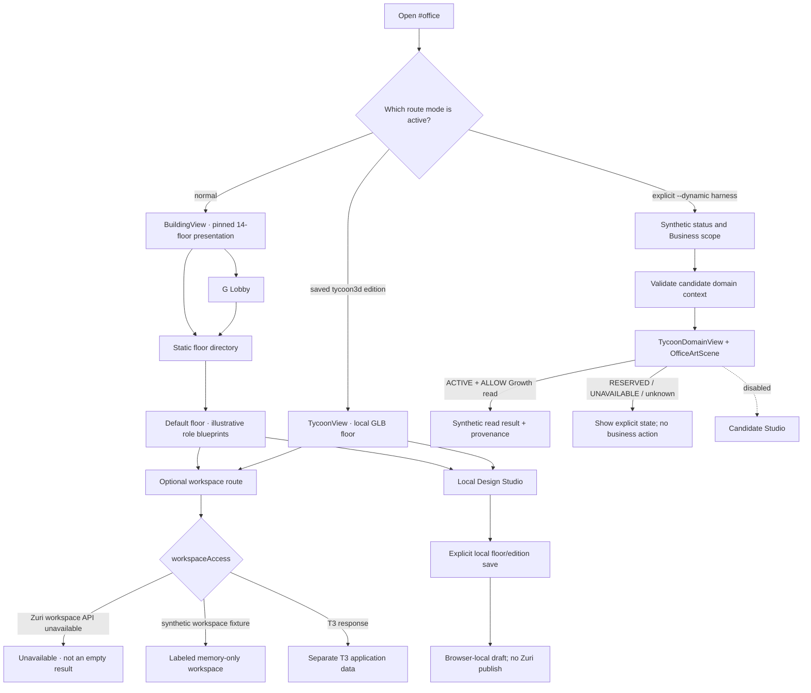
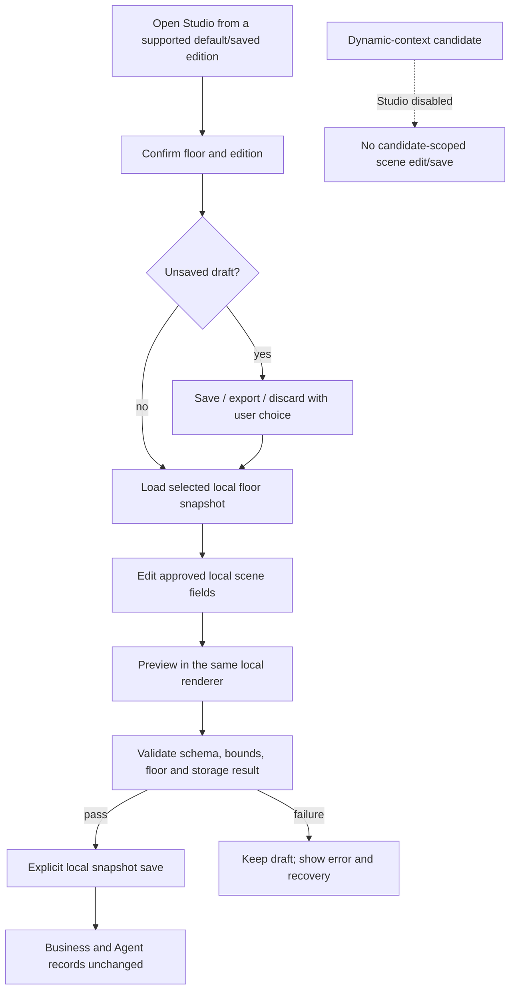

# Visual Office: wireframes, wireflow and user flows

This document describes the current local route modes separately from proposed
platform behavior. It is reconciled to Visual Office source revision
`949736446824d4803f9109a20830202494abd7b7`. It does not claim user testing, device
acceptance or live Zuri integration.

## 1. Route modes and shell

The legacy Marketing/CRM dashboard, persistent sidebar and duplicate task list were
removed from the app. The current shared workspace header/dock remains for workspace
pages; `web/app.js` hides it when Office is active. Office-owned navigation still
appears inside its selected renderer; it can include a floor directory, dock, toolbar
or contextual sheet.

| Route mode | How it is selected | Current screen and data meaning |
| --- | --- | --- |
| Default Office | Normal `#office`, `#office/lobby` and `#office/<floor>` navigation | `BuildingView` shows the campus overview, Lobby and pinned 14-floor presentation mapping from `web/domain-office.js`. Its role blueprints are examples, not a Business-authorized domain list or Agent roster. |
| Saved GLB edition | An eligible floor (`lobby`, `projects` or `growth`) has a locally saved `tycoon3d` edition in `TycoonStore` | `TycoonView`/`TycoonScene` renders that selected local edition. GLB/Native Studio remain active local features; GLB is not the normal default. |
| Dynamic-context candidate | Explicit local `--dynamic` synthetic harness profile | `TycoonDomainView` uses `OfficeContextData` and `OfficeArtScene`. Its directory uses the validated synthetic candidate context; this is not live Zuri authorization. |

## 2. Default Office screens

### Building overview — `#office`

The default `BuildingView` uses the existing campus artwork and Office-owned
controls. The floor map is a pinned presentation snapshot with 14 illustrative
floor keys. It does not change when a Business is selected and cannot grant access
to any Zuri domain. The older shared application shell is hidden here; the in-Office
directory and controls are still visible.

The campus artwork is not a green GLB prototype scene. GLB rendering is available
only when a supported floor has a saved local `tycoon3d` edition. Current ordinary
floor rendering and saved presentation state remain edition-specific.

### Lobby — `#office/lobby`

The user enters G Lobby from the building shortcut or floor navigation. The Lobby
provides Office-owned entry points such as the lift/directory and Reception. Selecting
a directory row changes the floor route; it does not perform an authorization check
or create a Business/domain record.

### Default floor — `#office/<floor>`

The default directory opens a floor from the pinned map. Four role blueprints are
illustrative presentation content. T3-connected profile/session information remains
T3 application data and is not a Zuri AgentDefinition, assignment or permission.
Artwork, seating and character animation never establish roster identity or Agent
status. Live Zuri roster parity remains blocked on an approved platform contract.

The scene has list/tool controls in addition to clickable objects. Error, loading,
offline and reserved states must be presented as states, not as an empty successful
read. Any Business action requires the relevant owner API and a confirmed response;
no generic Office Agent-dispatch action is available.

## 3. Dynamic-context candidate screens

The candidate profile is available only in the local synthetic harness. It injects
`office-domain-context/v1-candidate`; `web/app.js` selects `TycoonDomainView` and the
view displays `SYNTHETIC · CONTRACT CANDIDATE · ไม่เชื่อม live`.

1. The user opens the local `--dynamic` harness and waits for the synthetic status
   and Business scope response.
2. The user selects a Business from that synthetic scope.
3. `OfficeContextData` validates the candidate context shape, selected Business,
   revisions, generated time, availability and read-operation hints.
4. The directory displays only candidate domain rows. Route navigation is accepted
   only for a key present in the current context.
5. A Growth read is available only when its domain is `ACTIVE` and the matching
   operation hint is `ALLOW`: `marketing.campaigns.read` or
   `marketing.overview.read`. Candidate `actions` is empty; no Agent command or
   project/work mutation is offered.
6. Context expires after 60 seconds and is purged when the document is hidden or the
   selected context changes. Candidate Studio is disabled; candidate scope is never
   saved to a floor file.

Candidate building and Lobby art reuse the existing campus/Lobby images. Candidate
floor rendering uses `OfficeArtScene` with the painted `HybridScene` artwork; it does
not switch to the green GLB prototype. In this route, campus Fit uses
`framing: 'cover'` with `overscan: 1.25`; floor Fit keeps the shared whole-scene
`contain` framing. These are source behaviors covered by
`tests/office-art-scene.test.mjs`; that test is not rendered visual acceptance.

## 4. Workspace pages and the separate T3 boundary

Chat, Work, Results, Knowledge, Team and Inbox are separate workspace pages. They
are controlled by `workspaceAccess` in `web/workspace-context.js`, not by the Office
floor map or the candidate domain context.

| Gate state | User-facing result | Boundary |
| --- | --- | --- |
| Not yet verified | Loading | Do not present an empty list. |
| Demo | Read-only sample | No business command or save. |
| Zuri enabled, no supported Zuri workspace API | Unavailable | Do not substitute T3 data or present it as an empty Zuri workspace. |
| No live workspace service response | Unavailable | Keep Office design/navigation separate. |
| Explicit `--workspace` synthetic profile with loopback response | Labeled synthetic workspace | Test-only in-memory Worker fixture; no real upstream calls. |
| T3-backed workspace response | T3 application data | Separate from Zuri Business domain/Agent authority. |

The direct browser T3 client was retired. The retained T3 bridge uses server-side
`/api/runner/*` routes and its own sync-key boundary; the browser proxy excludes
those routes. T3 chat/job/profile data must not be relabeled as a Zuri Agent roster.
See [API-ENDPOINT-AUDIT.md](API-ENDPOINT-AUDIT.md).

## 5. Wireflow

## 6. State labels and recovery

| State | Display | Must not imply |
| --- | --- | --- |
| Default pinned floor | “ตัวอย่าง / local presentation” as appropriate | Authorized dynamic domain list or real Agent roster |
| Synthetic candidate | `SYNTHETIC · CONTRACT CANDIDATE · ไม่เชื่อม live` | Production login, live authorization or platform adoption |
| Loading / checking | Current operation and selected context | Zero records or success |
| `ACTIVE` + allowed read | Candidate source/revision/time and bounded result | A write permission or Agent command |
| `RESERVED` | Reserved label and no active reader/action | Operational floor access |
| `UNAVAILABLE`, `FORBIDDEN`, `AUTH_REQUIRED`, expired | Explicit reason and safe retry/return path | Empty success or a guessed permission |
| Workspace unavailable | No supported workspace data source | Empty T3/Zuri data or failed live read as a successful list |
| Unsaved local scene | Draft/unsaved state and available export/save choice | Shared save or publication to Zuri |

## 7. Designer flow

Scene drafts and assets remain local. A JSON import/export is an explicit user file
exchange and is validated before apply. It does not create a shared asset catalog,
cross-device scene persistence, Agent assignment or business write.

## 8. Acceptance checklist and evidence boundary

- Default building, Lobby, elevator/directory and saved edition routes preserve their
  intended back/refresh context.
- Directory and scene hotspots have keyboard/list alternatives; visible focus and
  names remain available without WebGL.
- Reserved, unavailable, forbidden, loading, synthetic and local-draft states are
  distinct and are not shown as zero-valued success.
- Role blueprints and T3 workspace profiles are labeled separately from any future
  canonical Zuri roster.
- Zuri workspace API absence gates workspace pages; synthetic workspace is visibly
  labeled and memory-only.
- Local scene save/import/export does not publish scene, Business or Agent data.
- 44 CSS px touch targets, screen-reader behavior, reduced-motion, mobile layout and
  cross-device browser behavior remain acceptance requirements; this document does
  not claim that human/device acceptance ran.
- Main CI run `40326980103` is repository evidence for source revision
  `949736446824d4803f9109a20830202494abd7b7` (747 tests, 412 embedded build assets,
  compatibility `PASS`). It does not establish live Zuri or visual user acceptance.

## 9. Source map

- Route selection and workspace gate: `web/app.js`, `web/workspace-navigation.js`,
  `web/workspace-context.js`.
- Default building, Lobby and floor presentation: `web/building-view.js`,
  `web/lobby-view.js`, `web/domain-office.js`.
- Saved GLB edition: `web/tycoon-view.js`, `web/tycoon-state.js`, `web/tycoon-scene.js`.
- Synthetic candidate and painted art: `web/tycoon-domain-view.js`,
  `web/office-context-data.js`, `web/office-domain-context.js`,
  `web/office-context-route.js`, `web/office-art-scene.js`.
- Scene editing and local persistence: [HYBRID-STUDIO.md](HYBRID-STUDIO.md),
  [NATIVE-STUDIO.md](NATIVE-STUDIO.md), [OFFICE-BLUEPRINTS.md](OFFICE-BLUEPRINTS.md).
- System routing, ownership and target platform boundaries:
  [ARCHITECTURE.md](ARCHITECTURE.md), [VISUAL-OFFICE-SRS.md](VISUAL-OFFICE-SRS.md),
  [ZURI-PLATFORM-INTEGRATION-BOUNDARY.md](ZURI-PLATFORM-INTEGRATION-BOUNDARY.md).
- Route policy, browser proxy, runner exclusion and live limits:
  [API-ENDPOINT-AUDIT.md](API-ENDPOINT-AUDIT.md).
- Design-source chronology: [DESIGN-SOURCES.md](DESIGN-SOURCES.md); source-level
  current route behavior is summarized above and in [ARCHITECTURE.md](ARCHITECTURE.md).
