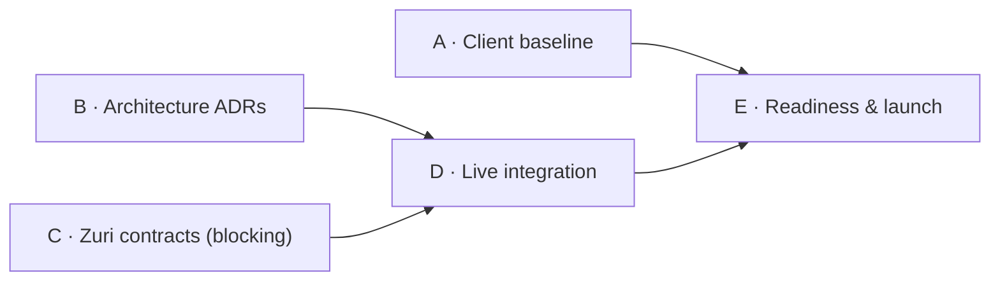

# Visual Office — roadmap to production

Status: **proposed** (drafted by the lead on 7 November 2026). Phase order, exit
criteria and owners below are a proposal until the owner accepts them. This
document sequences existing open items; it does not create requirements, approve
contracts or claim evidence. Requirement status stays in
[VISUAL-OFFICE-SRS.md](VISUAL-OFFICE-SRS.md) §13 (GAP-01..GAP-09) and current gap
status in [SYSTEM-GAP-ANALYSIS.md](SYSTEM-GAP-ANALYSIS.md) (G1..G7). The Zuri-side
delivery record is the zuri.ai roadmap, PHASE-ZAI-04 (TASK-ZAI-019..023).

## Where we are (7 November 2026)

- Local-first browser client with a same-origin Worker; editors, scenes and
  storage are local (localStorage/IndexedDB, validated JSON export). Public repo
  `Freshair129/visual-office`, CI green on every change.
- Closed locally: G1 (character runtime), G2 (stale review overwrite), G3 (HTML
  audit), G7 (reserved-floor actions). Art for Zuri R4, Wangjai, Staff A/B
  approved; G6 desktop qualified.
- Open: G4 accessibility (in progress), G5 business contracts (Zuri-owned),
  G6 mobile performance (draw-call reduction in progress; physical-phone test
  deferred by the owner), and SRS GAP-01..GAP-09.
- No hosting configuration, auth or shared scene service exists yet. Zuri.ai
  ADR-116 (accepted 7 November 2026) fixes the boundary: Visual Office is a
  separate-repository client, served by Zuri same-origin at `/office/` for the
  first slice, reading a dedicated Office snapshot contract and writing through
  the owning domains' contracts; it is not a separate service. Everything live is
  gated on Zuri contracts.

## Principles

1. Never invent Zuri endpoints, identities or permissions; integrate only
   owner-published contracts (G5, GAP-01..04).
2. Browser storage is not the production store for shared scenes (GAP-05).
3. Each phase ends on evidence (tests, CI, measured runs, owner sign-off), not on
   dates or checkboxes.
4. Phases A and B can run now; C onward waits for the dependencies named.

## Phase A — Client quality baseline (Visual Office; now)

| Item | Exit evidence | Owner |
| --- | --- | --- |
| G4 accessibility: lifecycle, names, keyboard/focus, contrast, canvas alternative | Static/DOM tests in CI; lead browser keyboard walk-through recorded; screen-reader pass (NVDA or VoiceOver) recorded | Visual Office; QA for AT pass |
| G6 draw-call reduction (≤ 30 meshes per character) | Budget test in CI (with assets); `perf:hybrid` desktop and 4×/6× proxy re-measured against the accepted budget | Visual Office |
| Data model documented | [DATA-MODEL.md](DATA-MODEL.md) reviewed against code; its open items resolved: Worker `office/preferences.json` is global (no Business/user scope), the last Business ID is kept in localStorage, Hybrid import limit differs between picker (350 KB) and parser (2.5 MB) | Visual Office |
| Supported browser/device baseline (GAP-07) | Agreed list of browsers and a lowest supported device; physical-phone measurement (deferred) scheduled | Product/QA |

## Phase B — Production architecture decisions (Visual Office + platform)

| Item | Exit evidence | Owner |
| --- | --- | --- |
| Hosting/deploy target | Decided by zuri.ai ADR-116 (accepted 7 November 2026): Zuri serves a hash-pinned Visual Office release at `/office/` on its own origin, with a strict CSP and manifest-listed assets only; a separate origin is the fallback after the registered-client contract. Remaining: [Visual Office release artifact, provenance and CSP check](OFFICE-RELEASE.md), staging environment, and where the Office Worker (T3 runner data only) runs | Visual Office + Zuri platform |
| Shared scene state service (GAP-05) | ADR: storage, versioning, audit, conflict/offline rules, migration from local stores (see DATA-MODEL.md) | Visual Office + platform architecture |
| Asset storage and delivery (GAP-06) | ADR: object store/CDN for GLB/preview/source, immutable revision + hash (extends asset-store/manifest.json), access and lifecycle; local-first + handoff RustFS remains for development | Visual Office asset owner |
| Observability and operations | Error reporting, frontend performance telemetry, Worker logs, uptime checks; incident/rollback runbook | Visual Office |
| Security review | Threat model for client, Worker, handoff popup and file import; dependency and CSP review | Visual Office + security owner |

## Phase C — Zuri contracts (Zuri owner; blocking)

| Item | Exit evidence | Owner |
| --- | --- | --- |
| GAP-01 hierarchy contract | Published canonical reference for this client | Zuri product/domain owner |
| GAP-02 Office snapshot contract (ADR-116 decision 2) and, only for a separate origin, client registration and auth | Snapshot FR + JSON Schema + fixtures in zuri.ai `apps/server/contracts/`; approval route gains idempotency/revision (ADR-116 decision 3) | Zuri platform owner |
| GAP-03 Agent roster, roles and action capabilities per Business/domain | Published contract + fixture; templates are not running agents | Zuri Agent owner |
| GAP-04 reserved/unsupported domain responses | Published behaviour per Business | Domain registry/API owner |

Visual Office prepares contract tests against each fixture as soon as it is
published; nothing is enabled live before Phase D.

## Phase D — Live integration (maps to TASK-ZAI-019..023)

| Item | Exit evidence | Zuri task |
| --- | --- | --- |
| Business-scoped scene route/shell in the registered client | Contract tests + staging run with real auth | TASK-ZAI-019 |
| Bind Business, Agent, Mission and Approval reads | Live reads in staging with provenance; no synthetic data in live paths | TASK-ZAI-020 |
| Accessibility and reduced-motion contract accepted on the integrated surface | Phase A evidence re-run on staging | TASK-ZAI-021 |
| Live agent presence and mission tracking | Agreed latency met in staging; provider switching verified | TASK-ZAI-022 |
| L1–L4 approval queue in Office | Authorization binding and audit equivalence with Zuri verified | TASK-ZAI-023 |
| Shared scenes live (from Phase B decision) | Migration from local stores tested; conflict rules verified | — |

## Phase E — Production readiness and launch

| Item | Exit evidence | Owner |
| --- | --- | --- |
| Staging acceptance | Full checks on staging: CI, e2e on real auth, `perf:hybrid` on the device baseline, AT pass | Visual Office + QA |
| Load and failure tests | Worker and asset delivery under expected load; degraded-mode behaviour (Zuri unavailable, assets missing) verified | Visual Office |
| Release process | Versioned releases, changelog, deploy pipeline from `main` with manual production approval, tested rollback | Visual Office |
| Data and privacy | Retention for Worker-held files and scene history; no credentials or business payloads in client storage beyond the contract | Visual Office + Zuri owner |
| Owner go-live sign-off | Recorded owner approval naming the release | Owner |

Economy/upgrade proposals using real business evidence (GAP-09) are out of scope
for the first production release unless the owner adds them.

## Dependencies at a glance

## Next actions proposed by the lead

1. Finish Phase A items already in progress (G4 round 2, G6 draw calls, data model).
2. Open Phase B decisions for the `/office/` release artefact/CSP and shared scene
   state; they need the platform owner's input but not Zuri contracts.
3. Ask the Zuri owner for the GAP-01..04 contract timeline; until then, keep
   integration synthetic and clearly labelled.
4. Update the zuri.ai roadmap evidence for TASK-ZAI-019..023 to reference the
   public repository instead of revision `740eb1f`.
