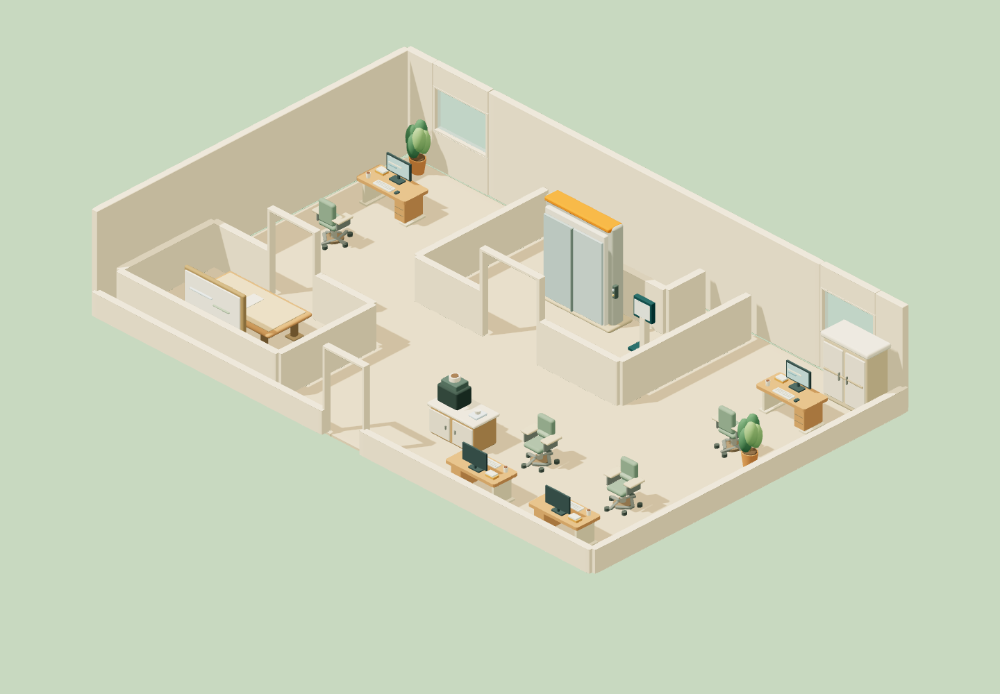
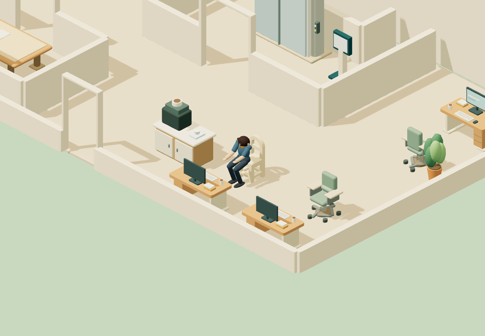

# Local verification: lower-limb collision and office plans

Date: 29 October 2026. Audience: implementation and visual reviewers. This is local test evidence, not product approval, deployment evidence, or a business/Agent status record.

## Implemented behavior

The local Three.js probe checks both thighs, shins and shoes against world-space triangles from assembled furniture and walls. Every proposed pose is swept from the last accepted pose at intervals of at most 2 cm, with a bounded sample budget. An excessive sweep, collision, or unreachable IK target stops the run and restores the last safe visible pose. Diagnostics name the object, limb, sampled geometry and rollback distance. A new manually started test explicitly hides and respawns its transient probe; movement between separate tests is not represented as a walked segment.

Sitting first places the feet beyond the measured chair front, keeps them planted in world coordinates while the root backs onto the seat edge, then moves the root forward while standing. Rig hip origins and bone lengths are preserved. Only thigh support on the selected chair's measured upper seat patch is exempted: upward normal at least 0.8, height within 2.5 cm, centerline at/above seat height minus 1 cm, and within 32 cm of the seat anchor. Chair legs, underside, armrests and other furniture remain collidable. The synthesized bundled-chair approach margin is 45 cm beyond its footprint to avoid the desk underside during entry and the settled final pose.

New default Lobby, Projects and Growth rooms have a shared lift core, enclosed shaft/service reserve, 1.8 m circulation, enclosed meeting room and reachable furniture stations. [The floor-plan note](TYCOON-FLOOR-PLANS.md) records the inspected real-office references and the remaining twelve candidate plans. Existing saved rooms are preserved; **ลองแปลนแบ่งห้องใหม่** loads an undoable Studio draft and **บันทึกชั้นนี้** persists it explicitly.

## Current evidence

The [GPU report](../../asset-source/blender/contact-runtime-v2/report.json) hashes the runner, runtime modules, actual factory desk/rig, bundled models and external fixtures before and after the run. `sourceUnchanged` is true. The renderer is Chrome with ANGLE / NVIDIA GeForce RTX 3060 / D3D11, at 1440 × 1000, DPR 1. Each deterministic simulation frame is rendered; 30/60 Hz here are timestep tests, not measured FPS.

| Production-scene case | Variants | 30 Hz | 60 Hz |
|---|---|---|---|
| Lobby, Projects and Growth routes | 3 floors | 3/3 complete | 3/3 complete |
| Kenney four-leg, rounded-back and swivel chairs | each at 0.9× and 1.1× | 6/6 complete | 6/6 complete |
| Bundled chair | 0.75×, 1× and 1.25× | 3/3 complete | 3/3 complete |

All eighteen seat runs exercised walking → entering → sit → working → standing → leaving → done, followed by more than two seconds of settling. External GLBs entered through the production custom-asset parser, IndexedDB store, descriptor and `TycoonScene.startStation` admission. They used the actual `desk-v3.glb`, actor rig, room geometry and collision world. There were no page errors or collision refusals in the final 24 cases.

The measured nearby-triangle clearance minimum was **4.51 mm**, excluding permitted seat support. This is not a global nearest-surface distance: broad-phase culled frames have `null` clearance. Foot-floor gap and planted-frame movement stayed below 0.001 mm in these flat-floor numerical samples, within acceptance limits of 3 mm and 4 mm respectively. These values are software-coordinate measurements, not physical metrology.

- `npm test`: **487/487 passed**, zero skipped/cancelled — [test output](../../asset-source/blender/contact-runtime-v2/tests.txt).
- `npm run build`: passed in `.local/collision-build-20261029`; 492 embedded assets — [build output](../../asset-source/blender/contact-runtime-v2/build.txt). Generated primary-checkout assets were not overwritten by the build.
- Focused regressions cover thin obstacles between clear endpoints, excessive sweep rejection, transformed furniture, narrow seat support, collision/IK rollback, renderer-independent activity, actual external GLBs, stored legacy rooms and Studio draft/Undo.
- Independent read-only review found no remaining source blocker after the explicit respawn correction. The subsequent durable GPU run covers that correction.

The separate [real-time profile](../../asset-source/blender/contact-runtime-v2/profile-rtx3060.json) ran each mode for 60 seconds on the same RTX 3060, Chrome 156.0.8078.48, at 1280 × 800 DPR 1. It continuously repeated the route/desk lifecycle instead of measuring an idle actor:

| Mode | Measured render FPS | Frame interval p95 | Motion failures |
|---|---:|---:|---:|
| Display rate | 59.90 | 16.8 ms | 0 |
| 30 FPS cap | 29.94 | 33.4 ms | 0 |

Both completed seven sequences (the initial route plus repeated station lifecycles); maximum draw calls were 199 and triangles 59,798. These are rendered-frame throughput observations from hardware-backed headless Chrome, not isolated GPU execution-time measurements or a universal device performance guarantee.

The earlier [failed diagnostic](../../asset-source/blender/contact-runtime-v2/prior-failed-diagnostic-4.json) is retained: normal-chair 30 Hz final settling and enlarged-chair entry hit the actual desk. Those failures prompted the approach-distance correction; that older report is not a current passing result. Node tests were also corrected to use the factory desk rather than the older procedural desk.

## Evidence images

The evidence directory also contains Lobby/Growth overview images and captured entry, sit, standing, leaving and final poses where those phases lasted long enough for a capture.

## Open limits

1. Collision covers lower limbs and the existing root navigation only. Hands still float above the keyboard in these clips; arms, torso, head, garment contact and seated ergonomics are not qualified.
2. There is no automatic sidestep, step-over, furniture movement or alternate-pose search. A path/pose outside the supported geometry stops safely; arbitrary imported chairs and arbitrary scales are not universally supported by these nine seat variants.
3. Capsules approximate the rendered limbs. Sweeps use sampled linear capsule endpoints with a 1 mm contact tolerance, not exact continuous mesh collision. The collision world is built from the assembled static scene; animated furniture, stairs, sloped floors, crowds and other rigs/scales remain unverified.
4. The [Kenney CC0 fixtures](../../tests/fixtures/external-chairs/README.md) preserve original source defects. QA remains false: degenerate faces 10/6/3, duplicate vertices 128/165/369; the swivel also has four back-to-back face pairs. Their imported lifecycle passes do not grant production asset-quality approval.
5. Only three floors have runtime layouts. The other twelve are documented spatial candidates. The shaft reserve does not implement lift travel, stairs or toilets, and these drawings are not construction/accessibility certification.
6. Evidence comes from one local probe on this GPU and viewport. No live Zuri backend, Agent identity, business workflow, permission, approval, multi-user acceptance or deployment was exercised.
7. This checkout contains earlier unrelated modified/untracked work. The scoped commits and local checks are not a claim that a clean checkout at their revisions alone reproduces the entire pre-existing prototype. No remote push or release is implied.
