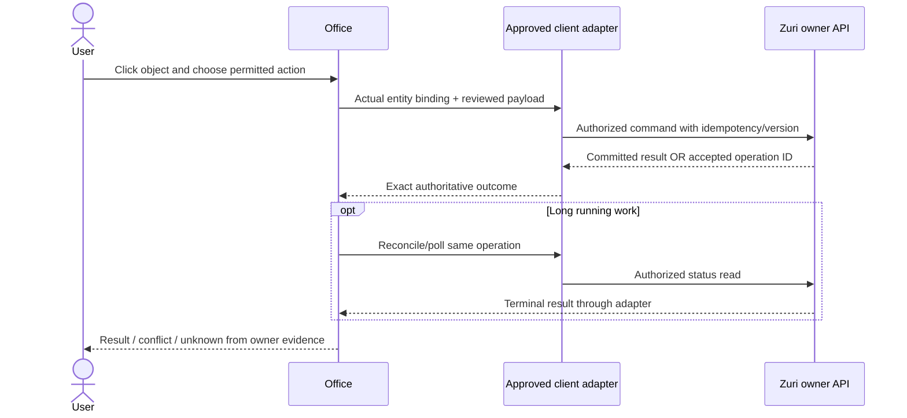

# Zuri dependency และการตรวจรับ vertical slice

## Current reconciliation — 26 October 2026

[PR #10](https://github.com/Freshair129/zuri-visual-office/pull/10) merged the runtime
cleanup and campus framing at main `94973644`; its
[CI](https://github.com/Freshair129/zuri-visual-office/actions/runs/40326980103)
passed 747 tests, build and pinned compatibility. [API audit](../API-ENDPOINT-AUDIT.md)
maps the 27 Office route families. Default/dynamic views now share the canonical
illustrated art; saved GLB/Native/Hybrid editions remain supported. The dynamic
directory is a synthetic scoped candidate, not a live platform grant/roster.

Chat/Work scene actions, loader fixes and editor tools have local/synthetic
regressions, but real Zuri Agent execution, shared scene persistence, final art,
physical devices and actual native hidden/focus lifecycle remain separate gates.
The 23–24 October counts, upstream snapshots and prototype gap tables below are
historical evidence; they must not override [the current SRS](../VISUAL-OFFICE-SRS.md).

## Local recovery refinement — 24 October 2026

[Recovery plan and current gap audit](../superpowers/plans/historical/2026-10-24-local-scene-recovery.md)
adds explicit 3D reload in Office and Studio. It recreates renderer resources without
reloading the page, reconnecting Business, saving or replacing an unsaved draft.
Context loss stops local probes; stale renderer errors cannot replace current feedback.
Source app and local built Worker browser checks cover GLB404, corrupt GLB hash,
context loss, recovery, draft/Undo retention, Campaign board and blank Ask.
430 unit tests and build pass. Ten floor switches retain one DOM scene canvas.
These checks partially advance T14/T15; they do not qualify GPU memory, 60-second
performance, physical devices, complete accessibility, final art, deployed Worker
or live integration. Earlier historical gap tables are not implementation inventories.

## Current integration and bounded responsive check — 24 October 2026

Marketing P1 is merged through [PR #1](https://github.com/Freshair129/zuri-visual-office/pull/1)
at `6de3a4540189837c0f376969f1e07193d93b50e4`. Its exact-main
[CI](https://github.com/Freshair129/zuri-visual-office/actions/runs/40066438063)
passed 427 tests, build (373 embedded assets) and 57 pinned producer vectors.
The actual app and local built-Worker handler passed the synthetic Campaign/Ask
matrix. B10 keyboard recovery/focus/Escape was checked separately, with a fresh
merged-Worker scope/board/blank-overview smoke. This is not a deployed Worker or live acceptance.

The follow-up [responsive plan](../superpowers/plans/historical/2026-10-24-marketing-responsive-acceptance.md)
checks 360x800 and 390x844 browser viewports. It found the Business control only
39.6px high and close control 41.7px wide; the stylesheet now preserves a 44px
minimum on both axes and prevents the close button shrinking. Browser remeasurement
confirmed 44x44 close, 44px Business height, reachable Campaign/Ask actions and
no horizontal sheet/document overflow in the checked views. Blank overview and
Lobby-to-Marketing navigation was observed at both sizes during the interactive run;
the retained JSON measures board/Ask geometry at both sizes and Business control
dimensions at 360px only. New evidence is in local
`reports/responsive/browser.json` and screenshots, separate from frozen P1 evidence.

T13 remains **partial**: these are two simulated browser sizes, not physical-phone,
screen-reader, reduced-motion or every-viewport acceptance. T07/T09/T10 live gates
remain unselected. Section 7 below is the historical first-prototype report, not
the current inventory of implemented Studio tools.

## P1 UI refinement — 24 October 2026

[Marketing P1](../superpowers/plans/historical/2026-10-24-marketing-p1.md) adds blank overview,
trimmed400 validation/counter, Campaign ID/displayed count, null/date-window labels
and recovery/focus fixes to the existing GLB Marketing pilot. Synthetic browser
qualification uses pinned producer payloads through the actual Node sanitizer on
an isolated local server. P0 fixture evidence stays frozen. Live acceptance and
actual Agent dispatch remain unselected; see P1 evidence for precise browser scope.

## Latest refinement — Marketing read pilot, 24 October 2026

Owner approved the read-only profile after the peer review. Office adds `growth`
as a labeled Marketing pilot using existing GLB props, a Campaign board and an
AskMarketing kiosk; Studio can save that floor independently. Current upstream
scope is `/api/entry` (the older `/api/scope` row below is historical).
`GET /api/growth/campaigns` and `POST /api/growth/ask-marketing` remain the only
Marketing operations. Ask is deterministic read composition, not Agent execution.

Trimmed questions are limited to 400; Ask responses require matching Business,
schema version 1.0 and known read states. Only source/state/reasonCode and generatedAt are displayed for provenance;
source owner/version/ref/window and private brief fields are omitted. HTTP 403/404 are both
normalized to identical complete denial envelopes for Entry and Marketing, including
source.status=403 and omission of sourceCode; HTTP 401 remains distinct. Scope/floor changes
invalidate pending reads; authorization denial clears cached scope and projections.

Implementation plan: [Marketing Office execution](../superpowers/plans/historical/2026-10-24-marketing-read-pilot.md).
Consumer fixture tests and preview browser checks are local evidence only. Shared
producer-generated fixture qualification passed all 57 vectors on the pinned file
(hash and exact dirty-source evidence in the shared-vector plan). Authenticated live
acceptance remains open pending the named environment/revision handoff. Dynamic floors, actual Agent roster,
dispatch, hosted auth and shared scenes remain separate ZD dependencies. Zuri-Go
implementation is outside this phase.

เอกสารนี้รวมหลักฐานสำรวจ source, test plan และผลต้นแบบเฉพาะส่วนใน §7
ยังไม่ใช่ผลตรวจรับ connected slice หรือ production
ใช้คู่กับ [Design](../superpowers/specs/historical/2026-10-23-office-tycoon-design.md)
และ [integration boundary](../ZURI-PLATFORM-INTEGRATION-BOUNDARY.md)

## 1. Baseline ที่ตรวจจริง

- Office checkout `test/zuri-office-parity-harness`, HEAD
  `39b6992fe78c0e1bea66ae185fec513e1517b245` มีงานก่อนหน้าที่ยังไม่commitจำนวนมาก
  การสำรวจนี้อ่านworking source ไม่ใช่ภาพของHEADเพียงอย่างเดียว
- Zuri `origin/main` หลัง `git fetch origin main` วันที่23ตุลาคม:
  `635120c552de9b456b6ab80e98b529211fc3d888`
  primary HEAD `9db638398140f48ffa518ca62b5163ac3377b11e` เป็นอีกrevision
  ใช้ `git show origin/main:<path>` สำหรับrouteที่อ้างด้านล่าง
  ระหว่างงาน main เดินต่อเป็น `64e23f31e76128bdb7a6392fda4bf51344e67b97` (PR #731)
  ตรวจซ้ำตอน23:40พบ primary HEADตรงorigin/main; diffของ project/work/scope routes,
  architectureและdomain docsที่สำรวจไม่เปลี่ยนจากฐาน635120c จึงไม่เปลี่ยนข้อสรุปข้างล่าง
- Approved architecture directionอยู่ในworktree
  `C:/Users/suanr/.codex/worktrees/visual-office-client-docs/zuri.ai/docs/architecture/2026-10-22-visual-office-zuri-client-design.md`
  version0.2.0: optional registered webclient, Zuriownsidentity/API; documentมีlocalstagedstate
  อย่าอ้างว่าdesignนี้mergedบนmainแล้ว
- `docs/plans/PLAN-VISUAL-OFFICE-ZURI-CLIENT-INTEGRATION.md` ที่sessionเก่าเคยชี้
  ไม่พบในprimary/currentmainหรือworktreeclient-docsที่ตรวจ จึงไม่ใช้เป็นexecutedplan
- manifestStudioมี20GLBentries; `hybrid-office-3d.js` ยังเรียกfactoriesโดยตรง
  GLBcatalogพร้อมบางส่วนไม่เท่ากับtycoonGLBruntimeพร้อม
- เบราว์เซอร์รอบนี้แสดง `This site can't be reached` ที่4182 และไม่พบlistenerบน
  4182/3100/3000 จากการตรวจครั้งนี้ จึงไม่มีfreshlive-readหรือcommandtest
  ไม่ใช้ภาพหรือผลทดสอบsessionก่อนเป็นผลใหม่

## 2. Available source ≠ approved Office contract ≠ runtime verified

| ความสามารถ | Sourceที่ตรวจ | สิ่งที่ยืนยันได้ | งานที่ยังต้องได้ |
| --- | --- | --- | --- |
| เลือกBusiness | Office `/api/zuri/scope`→Zuri`/api/scope` ผ่านloopbackconnector | มีdevelopmentreadpath | freshauthorizedsessionและregisteredclientcontractสำหรับhosted |
| รายชื่อProjects | Office `getDomain('projects',businessId)`→Zuri`GET /api/projects` | connectorรองรับitems/limit/truncated; mainrouteauthorizeviewer/scope | runtimeทดสอบselectedBusinessและpayloadcompatibility |
| งานในProject | main `apps/server/src/app/api/work/route.js` | มีGETที่authorizeProject/Workstream/Business | Officeconnectorยังไม่มีworkread; ownerต้องรับreadmapping,boundsและschema |
| Project/workCRUD | main `/api/projects`และ`/api/work` POSTส่งเข้าowner service | routeมีจริงและตรวจviewer | ไม่ใช่generalAgentdispatchหรือการอนุญาตให้Officeเพิ่มทุกmutation |
| Agent roster/role | Office domain-officeมีillustrativeroles; ไม่มีacceptedBusinessrostercontractที่ตรวจพบ | ไม่มีหลักฐานliveAgentparity | actualAgentIDs,roles,visibility,capabilities,statusและfreshness |
| Agent command | Officeconnector`AGENT_UNAVAILABLE` = `NO_AUTHENTICATED_DOMAIN_AGENT_DISPATCH_API` | currentadapterไม่dispatchProjectsAgent | owner-approvedcommand+operation+result+retry/conflictcontract |
| PMexecution/MCP | mainมีexecution-run/approvalroutesและPMtransport | มีdomain-specificexecutionfunctions | ห้ามอนุมานว่าเป็นgenericOfficechat/agentendpointหรือเปิดสิทธิ์ใหม่เอง |
| Proposedexecution schema | [ZURI-OFFICE-EXECUTION-CONTRACT-V1](../ZURI-OFFICE-EXECUTION-CONTRACT-V1.md) | Officeproposal+referenceguards | ยังไม่adoptedproducer/consumercontract; schemaผ่านไม่ใช่runสำเร็จ |
| Scenepersistence | RoomStore + office-floor/v1 | browserlocal+explicitJSONfile | sharedresourceowner/version/auditcontractถ้าจะใช้ข้ามเครื่อง |

แยก Projects collection ออกจาก WorkItem list; 25Projects ไม่ใช่25Tasks
pagination/truncationต้องแสดงอย่างตรงไปตรงมา ไม่มีuniversal tasks_done/tasks_total
เป็นprogressทุกProject; ใช้progressStrategy/roll-upที่Zuriส่งมาเท่านั้น

## 3. Dependency สำหรับเจ้าของ Zuri

นี่เป็นรายการข้อมูลที่ทีมต้องประสาน ไม่ใช่APIใหม่ที่Officeกำหนดฝ่ายเดียว
ผู้ใช้มอบหมายให้ตรวจและต่อfrontendแล้ว; contractapprovalยังต้องเป็นของplatformowner

| Dependency | Owner | สิ่งที่ต้องส่งมาเพื่อปิดข้อรอ | งานOfficeที่ติด |
| --- | --- | --- | --- |
| ZD1 Clientauth | identity/platform | allowedorigins/registration/session/signin/revoke/scopes และตัวอย่างdenied | hostedlogin และlivecontext |
| ZD2 Business/domainprojection | platform/domainowners | visibleleafdomains/modules/availability/sourceversion/observedAt+schema/fixtures | livebuildingfloors; modules/groupsไม่สร้างfloor |
| ZD3 Project/workreads | ProjectManager | schema/bounds/paging,Projectownership,authoritativeempty/errors,links/contextsemantics | projectboardและworkstations |
| ZD4 Agentroster/actions | Agent/runtime + PM | IDs/roles/status,actioncapabilities,bindingกับProject/domain,emptyroster | livecharactersและcommandCTA |
| ZD5 Commands/results | domain/APIowner | actionpayload,permission,expectedversion,idempotency,durableoperation,result/artifact,audit,timeout/reconcile | ส่งงานจากOfficeและยืนยันผล |
| ZD6 Statusdelivery | API/runtimeowner | approvedpollหรือeventschema,ordering/gaps/expiry/reconnect | bubblesและpendingoperationrefresh |
| ZD7 Sharedscenes | presentationresourceowner | designatedresource,scope/version/conflict/audit/exportpolicy | sharedsaveเท่านั้น; ไม่ขวางlocalStudio |

ZD1–6 ต้องมีaccepted sourceและproducer/consumer testsก่อนเรียกconnected sliceครบ
ZD7เลื่อนไปหลังpilotได้โดยUIบอกชัดว่า“บันทึกในเครื่องนี้”และมีexport
ไม่ขอรหัสผ่านในแชต ไม่คัดsession/tokenลงlocalStorageหรือไฟล์scene

## 4. Interface mapping ที่ frontend ใช้ได้

| Intentจากวัตถุ | เจ้าของข้อมูล | Preconditions | ผลที่แสดง |
| --- | --- | --- | --- |
| `choose-business` | authorizedscope | validZurisession | เปลี่ยนcontextแล้วclearข้อมูล/operationsจากscopeเก่า |
| `choose-floor` | authorizeddomains | domainvisible | navigationเท่านั้น |
| `view-projects` | PMread | selectedauthorizedBusiness | projectcollectionหรือempty/denied/unavailable |
| `view-work` | PMread | selectedProjectที่ตรวจscopeแล้ว | scopedWorkItems ไม่เอางานT3มารวม |
| `view-agent` | Agentread | actualAgentbindingในscopeนี้ | actualrole/status/sourceobservedAt |
| `request-action` | approvedactionowner | capability+payloadvalidation+resourceversion | committedresultหรือacceptedoperation; timeoutเป็นunknown |
| `view-operation` | operationowner | operationอยู่scopeปัจจุบัน | authoritativepending/terminalstate |
| `edit-floor` | localStudio | currentfloor/dirtyguard | localdraft/save/export แยกจากbusinessmutation |

ชื่อintentเป็นclientpresentationproposal **ไม่ใช่ชื่อendpoint/actionของZuri**
wireadapterเฉพาะmappingที่ownerยืนยัน; importsceneสั่งnetwork/JSโดยตรงไม่ได้

## 5. Acceptance matrix

ตารางนี้เป็นเกณฑ์ตรวจรับทั้ง slice; ผลที่ทำได้จริงและส่วนที่ยังไม่ทดสอบอยู่ใน §7
ห้ามใช้ผล unit tests แทนการผ่านทุกข้อของตาราง

| Test | วิธีตรวจ / สิ่งที่ต้องผ่าน | Requirement |
| --- | --- | --- |
| T01 Building→Lobby→Projects | mouse,touch,keyboard; sceneเต็มพื้นที่ไม่มีsidebarหรือinvisiblefocusrail; Back/refreshถูกชั้น | VO-FR-001/002/020/021/024 |
| T02 Directflooraccess | กดProjectsจากอาคาร,เปิดboard,เลือกProject ≤3clicks; route/contextไม่เปลี่ยนเอง | VO-FR-024/025 |
| T03 RealGLB | networkโหลดGLBhashตามmanifest; parsedmeshes/animationsในruntime; errorassetยังมีtextnavigation | VO-FR-018/026 |
| T04 Grounding | hero/top/side;โต๊ะเก้าอี้ถูกscale,ลิฟต์ติดผนัง,footcontact,depth/occlusion | VO-FR-026/027 |
| T05 Movement | desk/sofaapproach,occupiedseat,blockedroute,doorcloseระหว่างเดิน; no wall/deskpenetration | VO-FR-022/023/027 |
| T06 Editorparity | Lobby/Projects tycoon3d v2ต่างlayout;แก้/Undo/Save/reload/JSON roundtrip;legacyv1เปิด/export/สลับกลับได้; storagefailไม่ทับsnapshot;connectedlocalpresentationแยกpreview/Businessสองชุดตามdesign9.1–9.2 | VO-FR-013–020/028 |
| T07 Scopedread | realtestBusiness/Project,empty,noscope,401/403/404,partial,paging; projectcountไม่กลายเป็นworkcount | VO-FR-003–009/025 |
| T08 Rostertruth | N=0/1/4/>stations;exactreturnedIDs/roles, noillustrativeagentsในlive; missingrosterไม่เท่ากับzero | VO-FR-006/008/027 |
| T09 Command | allowedactionหนึ่งครั้งผ่านZuri;operationID+terminalresult;readback/auditตามcontract | VO-FR-010/011/025 |
| T10 Duplicate/conflict | doubleclick,retry,staleversion409/412,timeoutหลังcommit;ไม่เกิดงานซ้ำและคงdraft | VO-FR-010–012/025 |
| T11 Scopechange | เปลี่ยนBusiness/logoutระหว่างfetch/command/StudioSave;abortหรือdiscardlateผลscopeเก่า;localdraftแยกviewer/tenant/Business/floor;sceneexportไม่มีbusinessdataหรือbindings | VO-FR-009/025/028 |
| T12 Readonlyseparation | fixture/demo/animation/Studioไม่มีcanonicalwrite;T3routeไม่ถูกใช้เป็นZuri | VO-FR-010/017/027 |
| T13 Responsive/a11y | 1440×900,1024×768,390×844,360×800;44px,focus,screenreaderlabels,reducedmotion | VO-FR-021/024 |
| T14 Failure/recovery | WebGLcontextloss,GLB404/badhash,storagequota,snapshotmalformed,offline/reconnect | VO-FR-019/026/028 |
| T15 Performance | recordeddevice/browser/DPR,networksize,triangles/drawcalls,FPS60s,warm/coldload;disposeafter10floor switches | VO-NFRตามSRS; assetbudget |
| T16 Firstuse | ผู้ใช้เริ่มอาคาร เลือกBusiness ไปProjectsดูงาน ส่งคำสั่งและหาผลได้โดยไม่ต้องterminal | VO-FR-024/025 |

ทดสอบstate/errorที่เขียนclientได้ด้วยfixturesก่อน แล้วทำT07/T09/T10/T11บนZuri
environmentที่ได้รับอนุญาตและapprovedcontract; fixturePASSไม่ทำเครื่องหมายlivePASS
phoneviewportไม่เท่ากับphysicalphoneperformance ต้องระบุอุปกรณ์จริงเมื่อทดสอบ

## 6. หลักฐานและชื่อสถานะการส่งมอบ

| ป้ายส่งมอบ | สิ่งที่พิสูจน์ | ไม่ได้พิสูจน์ |
| --- | --- | --- |
| Designready | เอกสาร/diagram/sourceaudit/reviewครบ | code/GLBใหม่/runtime |
| Localplayable | navigation/objects/GLB/animation/Studioผ่านlocalchecks | livebusinessreadหรือAgentcommand |
| Connectedread | scopedreadพร้อมsource/version/freshnessผ่าน | dispatchAgent |
| Connectedsliceaccepted | T07–T12ผ่านกับactualcontract+ผลจริง รวมlocalart/UXgates | productiondeploymentหรือทุกdomain |

เก็บหลักฐานใต้ `reports/office-tycoon-<date>/` (ignored): sourceSHA/workingdiffdigest,
assetmanifestsha,environment/targetrevision,คำสั่งและจำนวนtests,screenshots,
operation/resultreferencesที่redactแล้ว,remainingdefectsและผู้ตรวจ
อย่าเก็บsessioncookie/token/privatepayloadเกินจำเป็น

เริ่มได้ด้วยคำสั่งexistingrepo: `npm test`, `npm run build`;
ถ้าเปิดpreviewใช้ `PORT=4182` ตามsyntaxPowerShellและ `node scripts/serve.mjs --preview`
localreadต้องเลือก`--zuri`และยืนยันtargetก่อน ไม่มีfreshliveevidenceในเอกสารฉบับนี้
ไม่เรียกgovernของZuriสำหรับOfficedocs และไม่แก้Zuri canonicalrecordsจากแพ็กเกจนี้

## 7. ผลต้นแบบรอบแรก — 24 ตุลาคม 2026

**สถานะ: local GLB prototype / partial implementation; connected slice ยังไม่ผ่าน**
ทำบน working tree เดิม ไม่มี commit/push/deploy ใหม่ ตัว preview :4182 ใช้ `--preview`
จึงไม่มีการ forward ข้อมูลหรือคำสั่งไป Zuri ในการทดสอบเบราว์เซอร์รอบนี้

สิ่งที่มีจริง:

- `tycoon-{state,models,scene,view,data,studio,activity}.js` และ GLB 24 ไฟล์จาก original procedural source
- GLB รวม 2,867,404 bytes; manifest SHA256
  `d381dcba7ce2014470b7dac3e7081099976eef3ee76033d65192431572520007`
  สร้างซ้ำด้วย input เดิมได้ manifest/hash ชุดเดิม ตรวจ GLB2 headers, meshes และ animation channels แล้ว
- อาคารสองชั้น, Lobby และ Projects ผ่านการเปิดในเบราว์เซอร์จริง; ใช้ fixed isometric camera,
  raycast, pan/zoom, HUD, dock และแผ่นรายละเอียด ไม่มี sidebar ใน Office
- Projects มีโต๊ะ 4 ชุดที่เป็นเฟอร์นิเจอร์ ตัวละครตัวอย่างหนึ่งตัวใช้ AnimationMixer เล่น walk
  และตรวจ furniture footprint ก่อนขยับ มี 7 named clips ใน GLB แต่ runtime ยังไม่ได้ครบ seat/door activity
- Studio ใช้ state และ renderer เดียวกับชั้นจริง; เพิ่ม/ลบ/สำเนา/ตำแหน่ง/rotation/scale/สี,
  Undo, local save, JSON v2 draft import/export และ dirty guard; ไม่รับ actor หรือ agent intent ในไฟล์ฉาก
- ตัวอ่าน Projects ใช้ connector เดิม ตรวจ target origin และ selected Business; stale reads ถูกทิ้ง
  ไม่มี accepted work/roster/command contract จึงไม่สร้าง endpoint ใหม่หรือแสดงผลส่งงานสำเร็จปลอม

หลักฐานเบราว์เซอร์: เข้าอาคาร→Lobby→บอร์ดลิฟต์→Projects; กดบอร์ดจาก canvas เปิดงาน;
หน้า 390×844 แสดง dock/แผ่นงานได้; แก้ desk-1 ด้วยแป้นลูกศรแล้ว Save→เข้าชั้น→reload→Studio
ค่าที่บันทึกยังอยู่ ทดสอบ numeric field ผ่านการพิมพ์ด้วยคำสั่ง fill รอบแรกไม่เกิด change event
จึงไม่ใช้ครั้งนั้นเป็นหลักฐาน save; รอบที่มี draft/Undo และค่าหลัง reload ตรงกันจึงนับเป็นหลักฐาน
ภาพอยู่ใต้ `reports/office-tycoon-design/`; viewport จำลองไม่ใช่ผลทดสอบโทรศัพท์จริง

| Gate | ผลรอบนี้ | ยังต้องทำ |
| --- | --- | --- |
| T01/T02/T13 | Partial local: เส้นทางหลัก, object sheet, mobile viewport, focus regression | ทุก viewport/keyboard/a11y และเลือก Project จาก live records |
| T03/T14 | Partial local: GLB/manifest/hash, missing WebGL text fallback, storage/revision/stale load tests | inject context loss และ asset failure ใน browser, recovery/performance บนอุปกรณ์จริง |
| T04 | Partial: metric bounds/pivots ผ่าน tests และตรวจ hero view | 5-angle visual QA, final art/contact/material approval |
| T05/T08 | Partial: demo walk, bounds/prop clearance, no authored/live fake roster | authored paths, seats/reservation, doors, actual roster/action binding |
| T06/T11 | Partial: floor save/import guards, Undo, legacy bytes, global dirty guards, stale scope tests | full Tycoon blueprint/group/layer/texture/navigation parity และ verified scoped local draft |
| T07/T09/T10/T16 | NOT RUN LIVE | accepted ZD1–6 และ authorized test environment |
| T12 | Local checks only | integration read/write acceptance บน Zuri |
| T15 | NOT RUN | 60-second profiling, ten-switch cleanup measurements และ physical device |

Independent GPT-6 Luna Max review พบ focus, dirty guard, authored actor, failed edition selection
และ stale GLB error branches; แก้พร้อม regression tests แล้ว ประเด็น global rail เดิมมี
`idle-active` CSS รองรับอยู่และ browser ตรวจว่าไม่แสดง ผู้รีวิวตรวจซ้ำแบบ static;
ผู้ทำงานเป็นผู้รัน tests/build ไม่อ้างว่าผู้รีวิวรันเอง

ผลตรวจสุดท้ายหลังแก้ review: `npm test` **363/363 ผ่าน, 0 skipped**;
`npm run build` ผ่าน พร้อม 361 embedded assets; ตรวจเอกสาร 6 ไฟล์, relative links 25 จุด,
Mermaid 5 diagram และ `git diff --check` ผ่าน เก็บผลรอบที่ล้มเหลวและ targeted reruns แยกไว้
ไม่รวมผลก่อนแก้เป็นผล final เดียวกัน ใช้ `tests-final.log` และ `build-final.log` เป็นผลสุดท้าย

งานถัดไปตาม workflow คือยกระดับ asset cards/หลายมุม, นำ authoring parity และ navigation/seat/door
มาเชื่อม Tycoon โดยใช้ geometry source เดียวกัน เครื่องมือเดิมยังใช้งานใน legacy edition ได้
และไม่มีการแปลงไฟล์เดิมอัตโนมัติ เริ่ม live commands ได้เมื่อ dependency ของ Zuri ถูกยืนยันเท่านั้น
