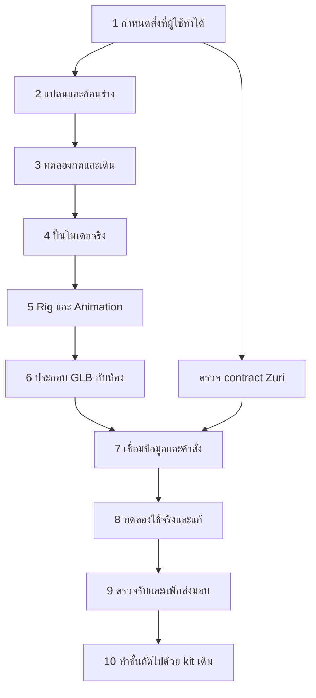

# Workflow ผลิต Office Tycoon แบบเกม

**26 October reconciliation:** this dated workflow remains the production
sequence, not an implementation inventory. The default shell now preserves
illustrated campus/Lobby/floor artwork; GLB remains an explicit edition/editor.
Use [the current package guide](README.md), [SRS](../VISUAL-OFFICE-SRS.md) and
[runtime audit](../API-ENDPOINT-AUDIT.md) for current completion/contract status.
Synthetic tests, provisional models and local saves do not close live/final-art gates.

อ่าน [Design](../superpowers/specs/2026-10-23-office-tycoon-design.md) ก่อน
นี่คือลำดับการผลิตของ vertical slice ที่ขอ ไม่ใช่รายงานว่าขั้นเหล่านี้เสร็จแล้ว
รายละเอียดสำหรับผู้พัฒนาระบุไฟล์/เกณฑ์เพียงพอให้แตกเป็น implementation tasks หลัง review

## ภาพรวมที่ผู้ใช้ไม่ต้องรู้ศัพท์เกมก็ทำงานร่วมกันได้



**ก้อนร่าง (greybox)** คือใช้ทรงง่ายตรวจขนาด/ทางเดิน/มุมก่อนลงทุนรายละเอียด
**kit** คือชุดชิ้นส่วนที่ใช้ซ้ำ **rig** คือข้อต่อให้ตัวละครเคลื่อนไหว
**vertical slice** คือหน้าอาคารกับสองห้องที่จบการทำงานจริงหนึ่งเส้นทาง
ไม่ต้องผลิต14ชั้นหรือ12ตัวละครใหม่ก่อนรู้ว่า flow ใช้ได้

## ลำดับงานและเกณฑ์จบแต่ละช่วง

| ช่วง | สิ่งที่ผู้พัฒนาต้องทำ | สิ่งที่ผู้ใช้ตรวจได้ | เกณฑ์ผ่าน / dependency |
| --- | --- | --- | --- |
| 0 สำรวจของเดิม | ตรวจ Git, source, scene schema, asset manifest, design profile และ Zuri main ที่ระบุSHA | รายการมีแล้ว/ต้องแก้/ขาด | ไม่มีสมมติว่า doc proposal คือ API; ไม่ทับ saved rooms |
| 1 Pre-production | กำหนด player loop, หน้าจอ, วัตถุ→action, แปลน, camera, asset list, acceptance | เอกสารชุดนี้ + wireframes | review design; API gapมีเจ้าของและหลักฐานที่ต้องขอ |
| 2 Greybox | อาคารG+Projects, Lobby12×8m, Projects12×8m; ใช้ของเดิมเป็น proxy | คลิกเข้าตึก/ชั้นได้; เห็นระยะเมตร | ทางเดินและ seatingพอ; มุมไม่มีสิ่งลอย/ทะลุ; ยังไม่ polish |
| 3 Interaction prototype | เอา sidebarจาก Office, HUD/dock/context sheet, object picking/keyboard, floor routing | กดบอร์ด โต๊ะ ตัวละคร เปิด sheetถูกตัว | ทดลองครบflowกับข้อมูลตัวอย่างที่ติดป้าย; ไม่ส่งคำสั่งธุรกิจ |
| 4 Art production | reuse/refine/create GLBตาม asset list; วัสดุ พื้นผิว pivots anchors | turntable/hero/top previewและบัตรasset | bytesเป็นGLBจริง, dimensionsตรง, IDs/hashesครบ, visual review |
| 5 Rig & animation | adult rig1ชุด,3appearance presets,7clips, prop door motion | เดิน/นั่ง/ลุก/ทำงาน; หยุดmotionได้ | ไม่เท้าไถ/ตัวลอย/ทะลุ; clipโหลดจากGLB; navคุมroot |
| 6 Assembly | loader/cache/material ownership, composeชั้นจากGLB+blueprint; เพิ่มtycoon3d/ไฟล์v2/localstoreใหม่ตามdesign9.1–9.2 | ฉากจริงแทนproxy, แต่งStudioกลับไปOffice; เลือกlegacyeditionกลับได้ | Lobby3D roundtrip, editorparity, contextisolationผ่าน; no silent migration |
| 7A Zuri read | adapterที่ยืนยันแล้ว, context+Project/work/roster+freshness | กดboardเห็นข้อมูลBusinessทดสอบจริง | identity/domain/work contractผ่าน; ภาพรวมอ่านอย่างเดียวแยกจากdispatch |
| 7B Zuri command | capability→action→owner command→operation→result | ส่งงานหนึ่งครั้งจากตัวละคร/โต๊ะแล้วได้ผลจริง | owner contractพร้อม; retry/conflict/deniedมีผลตรวจ; ไม่แทนด้วยT3 |
| 8 Playtest & hardening | first-use, desktop/mobile, slow network, reload, save, GPU/context loss | ผู้ใช้ลองด้วยตัวเอง, defect listพร้อมระดับผลกระทบ | แก้เส้นทางตัน/กดผิด/ข้อมูลไม่ตรงก่อนของตกแต่งเพิ่ม |
| 9 Release candidate | tests/build/review/evidence, asset licenses/hashes, version/rollback | ลิงก์previewและผลทดสอบที่ตรวจย้อนหลังได้ | connected sliceผ่านทุกข้อ; publishตามคำสั่ง/การควบคุมrepo |
| 10 Expand | ทำ domain mappingและวัตถุเฉพาะชั้นด้วยkitเดิม | เพิ่มชั้นโดยไม่รื้อshell | sliceผ่านและรับsourceของdomainใหม่; ไม่copyagent roleตัวอย่าง |

ขั้น4–6 ทำต่อได้ระหว่างรอ API หลัง designผ่าน แต่ขั้น7B/9 ห้ามทำเครื่องหมายผ่าน
โดยใช้ mock, เปิดลิงก์Zuri หรือดูanimationแทนคำสั่งจริง
ช่วง2–3ควร reviewเร็ว: เปลี่ยนผังหรือจุดกดตอนนั้นถูกกว่าปั้นงานละเอียดแล้วรื้อ

## 1. ก่อนปั้น: ล็อกชิ้นส่วนและผัง

1. อ่าน [รายการวัตถุ](TYCOON-ASSET-LIST.md) แล้วผูกทุกจุดสำคัญกับ user action
2. ขีด footprint, จุดapproach, ที่นั่ง, บานเปิด และระยะเดินใน blueprintเดียวกัน
3. วางกล้องที่45°/31.33°; ตรวจ desktopและportraitก่อนเลือกความสูงของผนัง
4. วาง proxyในScene Studio เปิดdoor/walk testก่อนอนุมัติ layout
5. บันทึกdefault templatesใหม่เป็นrevision ไม่เขียนทับlocalfloorที่ผู้ใช้แต่งแล้ว

แต่ละสถานีต้องมี recordชัดว่า: object ID, asset revision, footprint,
approach/seat/facing, interaction intent, caption และ source owner
เช่น `project-board-01`→ดูProjects ของBusinessที่เลือก; `desk-01`→เลือกงาน
ทั้งสองเป็นIDฉาก ไม่ใช่ Project ID/Agent ID ของ Zuri

## 2. วงจรผลิตโมเดลหนึ่งชิ้น

```text
Asset brief → proxy dimensions → mesh + bevel → material/UV
→ pivot/anchors/collision → export GLB → inspect bytes
→ import into app → preview/visual check → manifest revision → assemble floor
```

- ใช้ original procedural source ที่มีเป็นจุดเริ่ม หรือ editable Blender sourceเมื่อจำเป็น
- แยกโต๊ะกับเก้าอี้; ไม่ให้GLB deskแอบพกเก้าอี้ที่ซ้ำกับinstanceอีกตัว
- assetที่มีglass/textureตรวจalpha, normals, roughness, color spaceและdraw calls
- source→GLB ต้องทำซ้ำได้ มีเวอร์ชัน/sha256/ต้นทาง/licenseและข้อจำกัด
- ห้ามเรียกPNGว่าGLB; ห้ามแค่exportโดยruntimeยังสร้างอีกgeometryคนละชุด
- บันเดิลโมเดลก่อน; shared asset serviceไม่ใช่dependencyของการทดลองนี้

Toolchainที่ตรวจรอบนี้: `three`0.180.0 และ GLTFExporterของrepoมีอยู่จริง;
`game-dev`ไม่พบในPATHจาก Get-Command จึงยังไม่อ้าง CLI validation/Blender receipt
เลือกทำoriginal local geometry/exporterเดิมก่อน ไม่ส่งpaid providerหรือขอcredential
หากใช้game-devภายหลังให้capabilities/doctorก่อน แล้วใช้policy/inspectionตามเวอร์ชันที่ติดตั้ง
การไม่มีCLIไม่ขวางการเขียนdesignหรือทำlocal GLBผ่านpipelineเดิม แต่ต้องระบุvalidationที่ทำจริง

## 3. วงจรตัวละคร

หนึ่งrigใช้ซ้ำกับทุกตัวที่ได้รับอนุญาต เลือกappearanceเพื่อแยกสายตาเท่านั้น
ไม่มีชื่อroleเช่น“นักบัญชี”ฝังในmodelและไม่ใช้ศาสนา/รูปร่างเป็นประเภทตัวละคร

```text
neutral adult master → skeleton/pivots → skin/weights or rigid articulated joints
→ 7 named animation clips → GLB import → navigation-driven root + AnimationMixer
→ desk/sofa seat alignment → contact/occlusion/reduced-motion tests
```

มีprototype articulated geometryอยู่แล้ว แต่ยังไม่ใช่GLBพร้อมclipsที่ผ่านpipelineนี้
rigแบบข้อต่อ rigidใช้ได้ถ้าภาพที่ข้อต่อผ่านreview; ถ้าเห็นรอยแยกให้ใช้skinned mesh
ไม่สร้าง12rigแยก; เป้าหมายแรกหนึ่งrigสามappearance หลังผ่านค่อยขยายartชุดเดิม

## 4. Scene assembly และ Studio

| ขอบเขต | ไฟล์ที่มีอยู่และจะได้รับผล | ข้อควรรักษา |
| --- | --- | --- |
| Shell/routes | `web/app.js`, `web/index.html`, `web/workspace-navigation.js`, `web/office-workspace.css` | sidebar/dashboard เก่าถอดแล้ว; Work/Chat ใช้ shell ปัจจุบัน; รักษา Back/focus |
| อาคาร/Lobby/floor | `web/building-view.js`, `web/lobby-view.js`, CSSที่คู่กัน | แยกHUD/sheetออกเป็นcomponentย่อยแทนเพิ่มความซับซ้อนในไฟล์เดียว |
| Shared3D | `web/hybrid-office-3d.js`, `web/office-architecture.js`, `web/office-projection.js` | geometry/anchors/collisionต้องใช้sourceเดียว |
| Asset pipeline | `web/studio-models.js`, `web/office-assets.js`, `scripts/build-studio-assets.mjs` | แยกtycoonkitและcharacterexporterเมื่อเริ่มทำจริง; assetmanifest immutable revisions |
| Character/nav | `web/office-characters.js`, `web/office-navigation.js`, `web/office-activity.js` | navigationขับroot, animationไม่อ้างสถานะธุรกิจ |
| State/editor | `web/hybrid-state.js`, `web/hybrid-studio.js`, `web/native-state.js`, `web/native-studio.js` | floor/edition/Undo/JSON/texture/group/layer/doorไม่หาย |
| Business projection | `web/zuri-connector.js`, `web/zuri-panel.js`, `scripts/zuri-connector.mjs`, `web/floor-tasks.js` | ไม่ต่อprototypeexecution schemaเอง; ไม่เอาT3 jobsมาสวมZuri |

ก่อนลงcodeแตกtaskเฉพาะที่dependencyพร้อม พร้อมชื่อไฟล์/interface/testและผลที่คาด
ไม่เริ่มด้วยการrewriteแอปทั้งก้อน; shell,GLBloaderและbusinessadapterรับผิดชอบคนละส่วน

ขั้น2เริ่มด้วย draft format/validator ของ Tycoon เพื่อไม่ผูก Lobby ใหม่กับ native v1
ที่ไม่รองรับ Lobby; ขั้น6รวม editor/state/renderer parity ครบตามdesign9.1
ใช้ module/store ใหม่สำหรับ Tycoon แล้วให้ legacy import/router dispatch ตามversion
connected presentation มี namespace ตาม authorized identity ตามdesign9.2;
ก่อน ZD1/ZD2 พร้อมทดสอบได้ด้วย fixtures ที่ติดป้ายเท่านั้น ไม่อ้าง Business binding จริง

## 5. การทดสอบและการส่งงานแต่ละช่วง

ทุกช่วงส่ง: สิ่งที่เปลี่ยน, screenshot/clipที่เกี่ยวข้อง, คำสั่งcheckที่รันจริง,
ผลและช่องว่าง, revisionของsource/asset และขั้นถัดไป
รูปนิ่งพิสูจน์compositionได้แต่ไม่พิสูจน์การเดินหรือคำสั่ง; fixtureพิสูจน์clientlogic
ได้แต่ไม่พิสูจน์Zuriสด

ใช้ `node --test tests/<changed-behavior>.test.mjs` ระหว่างแก้ และ
`npm test`, `npm run build` สำหรับรวมsliceหลังcodeพร้อม; ตรวจจำนวนtestไม่ใช่exitcodeอย่างเดียว
ทำindependent reviewในpatchเดียวกับที่จะส่ง ไม่เอาหลักฐาน341testsของdoorfeature
มาอ้างว่าtycoonใหม่ผ่านแล้ว

ไม่กำหนดจำนวนวันก่อนรู้คุณภาพassetและcontractจริง ใช้gateที่ผู้ใช้ดูผลงานได้แทน
เมื่อขยายชั้นอื่นให้ทำซ้ำแค่ floor brief→domain interactions→scene composition→acceptance
แชร์building/HUD/loader/rigและการตรวจscopeเดิม
