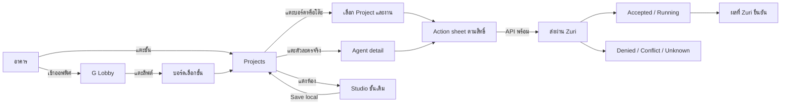
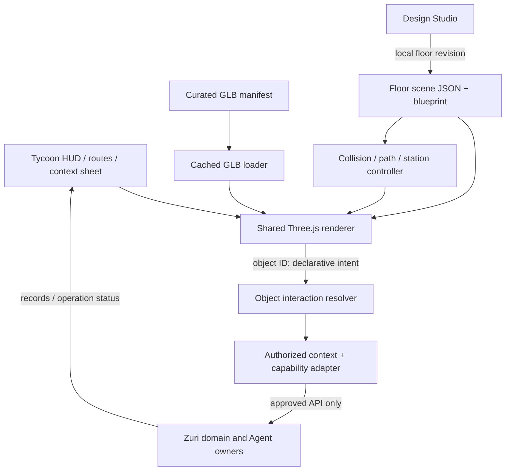

# Office Tycoon: ตัวอย่างครบวงจรของตึก, Lobby และ Projects

Owner approved v0.2 on 23 October 2026 and authorized implementation planning followed by the building/Lobby/Projects prototype. Implementation and live acceptance remain separate statuses.

## 1. เจตนาและขอบเขต

เปลี่ยนวิธีเข้าถึงงานธุรกิจเป็นสำนักงานที่แตะใช้งานได้ ผู้ใช้เห็นสถานที่และวัตถุที่
คุ้นเคย แล้วเปิดงานจากวัตถุนั้นได้ทันที ใช้ข้อมูลและคำสั่งจริงของ Zuri
คำว่า idle หมายถึงฉากมีชีวิตและติดตามงานที่รันต่อได้ ไม่ใช่ตัวนับเงินหรือความสำเร็จจำลอง

เจ้าของเลือก: เว็บแยกแบบ optional, อาคารแบ่งชั้นตาม domain, GLB จริง,
ไม่ใช้ sidebar ประจำใน Office, เริ่มแค่หน้าอาคาร/G Lobby/Projects และทำเอกสารก่อน
ตัวอย่างครบวงจร (vertical slice) คือส่วนเล็กที่มีทั้งภาพ, navigation, ข้อมูล,
คำสั่ง, ผลลัพธ์ และการกู้คืนเมื่อผิดพลาด ไม่ใช่การสร้างทุกชั้นแบบคร่าว ๆ

การออกแบบนี้ขยาย [SRS](../../VISUAL-OFFICE-SRS.md) VO-FR-001–023 ด้วย
VO-FR-024–028 และใช้ [wireframes](../../game-design/tycoon-wireframes.svg)
เป็นภาพโครง ไม่ใช่หลักฐาน implementation

### เป้าหมายการทดลองใช้

- ผู้ใช้ใหม่ไป Projects และเปิดงานจากบอร์ดได้ภายใน 3 การกดจากหน้าอาคาร
  โดยมีเส้นทางเข้า Lobby สำหรับการเรียนรู้ครั้งแรก
- กดโต๊ะ/ตัวละครแล้วทราบว่าเกี่ยวกับงานหรือ Agent ใด โดยไม่เดาจากสีเสื้อ/จำนวนเก้าอี้
- ส่งคำสั่งที่ Zuri รองรับเพียงครั้งเดียว เห็น accepted/running/result ตามข้อมูลจริง
- แต่งชั้นใน Studio แล้วกลับ Office ได้โดย state, ทางเดิน, ประตู และ interaction ตรงกัน
- ขณะไม่มีสิทธิ์/ข้อมูล/การเชื่อมต่อ UI อธิบายได้และกลับไปลองใหม่ได้

### ไม่รวมใน slice นี้

การผลิตชั้นอื่น, ระบบเงิน/แต้ม/ร้านค้า/รางวัล, paid model generation,
สร้าง Business หรือ Agent จากเฟอร์นิเจอร์, backend/database ใหม่ของ Office,
shared scene save ที่ยังไม่มี owner contract และ free-orbit camera
หน้า T3 เดิมยังเป็นอีกระบบหนึ่ง; ห้ามนำปุ่มสั่ง T3 มาติดป้าย Zuri

## 2. แนวทางที่เลือกและทางเลือก

ผู้ใช้เลือก GLB + ประสบการณ์ tycoon แล้ว ผู้พัฒนากำหนดรายละเอียดดังนี้:

| วิธี | ข้อแลกเปลี่ยน | ข้อสรุป |
| --- | --- | --- |
| Modular GLB + fixed orthographic isometric + pan/zoom | แชร์สัดส่วน/แสง/depth/ชนจริง ใช้โมเดลซ้ำได้; ต้องจัด asset/rig ให้ถูก | ใช้เป็น baseline ของ slice ตามทิศทางที่เจ้าของเลือก |
| GLB + หมุนกล้องอิสระ | ตรวจได้รอบด้าน แต่เลือกของยากขึ้น มีปัญหาผนังบังและเพิ่ม QA กล้อง | เก็บเป็นเครื่องมือ inspection ภายใน Studio; ยังไม่เปิดใน Office |
| Render sprites หลายมุม | เบากว่าในบางกรณี แต่จำนวนภาพ/animation เพิ่ม และรักษา depth กับผนังที่แก้ได้ยาก | ไม่ใช้แทน GLB; คงไว้เฉพาะ fallback/ฉากเก่า |

โมเดลต้องมีสามมิติครบ แต่กล้องใช้งานมีมุมหลักเดียว **ไม่ใช่โมเดลหน้าเดียว**
มุมตรวจงานและภาพ preview ดู [asset list](../../game-design/TYCOON-ASSET-LIST.md)

## 3. UX แบบฉากเต็มพื้นที่

Office routes `#office`, `#office/lobby`, `#office/projects` ใช้ play surface เต็มพื้นที่
นำ app rail/sidebar และแผง roster ค้างข้างฉากออกจาก layout และลำดับ Tab ของ Office
ย้ายสิ่งที่จำเป็นมาเป็น HUD และแผ่นรายละเอียดที่เปิดตามการกด (context sheet)
ไม่ลบ DOM ที่หน้า T3/Studio ยังอาศัยโดยไม่ปรับ owner ของ component นั้น

| ส่วน | หน้าที่ |
| --- | --- |
| HUD ด้านบน | Business ที่เลือก, ชื่อชั้น, สถานะการเชื่อมต่อ/ความสดข้อมูล; กดเพื่อเปลี่ยน Business/เชื่อมต่อ |
| ฉากกลาง | อาคารหรือห้องที่สร้างจากโมเดล มีป้ายที่กดได้; ไม่มีตัวเลขรายได้ปลอม |
| Dock ด้านล่าง 4 ปุ่ม | อาคาร · ชั้น · งาน · แต่งห้อง; แสดงป้ายข้อความและ selected state |
| ปุ่มกล้อง | ซูมเข้า/ออก/คืนมุม; drag พื้นว่างเพื่อเลื่อน ไม่ลากสิ่งของในโหมดใช้งาน |
| Context sheet | รายละเอียดวัตถุ/งาน/Agent และ action ตามสิทธิ์; เปิดได้ครั้งละหนึ่งแผ่น |
| Notice | แจ้ง error/ผลลัพธ์สั้น มีลิงก์ดูรายละเอียด; ไม่บังปุ่มหลักและไม่หายเร็วจนอ่านไม่ทัน |

Desktop sheet ลอยด้านล่างฉาก กว้างไม่เกิน 640 CSS px และสูงไม่เกิน 55vh;
mobile เป็น bottom sheet สูงเริ่มต้น 40vh ขยายได้ถึง 85dvh มีปิด/ย้อนกลับเสมอ
รายละเอียดเลื่อนได้ภายใน sheet ฉากไม่กระโดดกลับต้นทาง
นี่เป็นแผ่นรายละเอียดที่เปิดตามบริบท ไม่ใช่ sidebar ถาวรที่เปลี่ยนสีใหม่

ปุ่มเป้าหมายอย่างน้อย 44×44 CSS px; label แยกจาก texture ให้เปลี่ยนภาษาได้
keyboard ใช้ dock/รายการวัตถุใน sheet ไปยัง action เดียวกับ raycast
Escape ปิด sheet และคืน focus ที่ปุ่มเดิม; Back ย้อน route ไม่เปลี่ยน Business
เปิด sheet ต้องจัด focus/inert ให้ถูก ลด animation ตาม prefers-reduced-motion

## 4. หน้าอาคาร

อาคารมีฐาน/ทางเข้า, ชั้น G และชั้น Projects, หลังคา ใช้ facade module ซ้ำ
ข้อความชื่อ Business/ชั้นเป็น DOM overlay ที่ anchor กับโมเดล ไม่ bake ใน GLB

- ทางเข้าตึกหรือปุ่ม “เข้าออฟฟิศ” → G Lobby
- แตะชั้น Projects → Projects โดยตรงสำหรับผู้ใช้ที่รู้ทางแล้ว
- Dock “ชั้น” → directory เดียวกับลิฟต์ กด G/Projects ได้ด้วย keyboard
- หาก Zuri ให้ domain อื่นที่มีสิทธิ์: แสดงใน directory ว่า “ยังไม่มีฉากในรุ่นทดลอง”
  พร้อม navigation ไป Zuri เมื่อมีลิงก์ที่รองรับ ห้ามสื่อว่าไม่มีสิทธิ์หรือ domain ไม่มีอยู่
- ก่อนมี authorized snapshot ใช้แค่ตึกตัวอย่าง 2 ชั้นที่ติดป้าย “ตัวอย่างฉาก”
  ห้ามเอารายชื่อ pinned 14 domain มาอ้างเป็นตึกจริงของ Business

ไม่สร้าง Domain จากการ duplicate ชั้นและไม่ unlock งานธุรกิจด้วยการอัปเกรดอาคาร

## 5. Lobby เป็นจุดเริ่มต้น

แปลนใหม่เริ่มที่ 12×8m (ผู้พัฒนาเสนอ; เฉพาะ floor ที่ยังไม่มี saved layout)

| จุด | วัตถุ | การกด | ข้อมูล/ผล |
| --- | --- | --- | --- |
| ทางเข้า | ประตูและป้ายบริษัท | เข้า/กลับอาคาร | navigation เท่านั้น |
| Reception | เคาน์เตอร์และจอ | เลือก Business / ตรวจการเชื่อมต่อ | authenticated scope; ถ้ายังไม่พร้อมแสดงขั้นตอนเชื่อมต่อ |
| Lift | ประตูลิฟต์ + directory kiosk | เปิดบอร์ดชั้น แล้วเลือก Projects | authorized floor list หรือป้ายตัวอย่าง |
| Notice | บอร์ดสำนักงาน | เปิดคำแนะนำ/ทางไป Projects | pilot ไม่อ้างว่าเป็น inbox ข้ามทุก domain |
| Lounge | โซฟาและโต๊ะกลาง | รายละเอียดตกแต่ง/ลองนั่งเมื่ออยู่ Studio | ambient presentation; ไม่เปลี่ยนสถานะ Agent |
| Studio entry | ป้ายแต่งห้อง | เปิด Studio ที่ Lobby | คง floor key; dirty-state guard |

เส้นทางเข้า → Reception → lift เป็นทางหลักกว้างอย่างน้อย 1.2m
ไม่จำเป็นต้องรอ avatar เดินถึงวัตถุจึงเปิดงานได้ การเดินเป็น visual feedback
และไม่เป็นข้อจำกัดการทำธุรกิจของผู้ใช้

## 6. Projects เป็นชั้นต้นแบบทำงาน

แปลนมาตรฐาน 12×8m แบ่ง work zone, meeting nook และ lounge
จุดใช้งานจริงต้องเห็นได้จากกล้องโดยไม่อยู่หลังผนังเต็มความสูง

| วัตถุ | การเปิดครั้งแรก | Action เมื่อ source/สิทธิ์พร้อม |
| --- | --- | --- |
| Project board | รายชื่อ Projects ของ Business เลือก Project แล้วอ่านงานของ Project นั้น | ดูรายละเอียดงาน, กรองสถานะ, refresh, เปิดใน Zuri |
| Workstation/จอ | งานที่ผูกกับสถานี หรือให้เลือก Project หากยังไม่มี binding | เลือกงานแล้วเปิดรายละเอียด/คำสั่งที่ owner รองรับ |
| ตัวละคร | Agent ID/display name/role และงานจาก roster จริง | ส่งคำสั่งที่ได้รับอนุญาต, ดู operation/result; cancellation เฉพาะ API รองรับ |
| Meeting table | เป้าหมาย/แผนและการติดตาม Project ที่เลือก | เปิดหน้าที่รองรับใน Zuri; ไม่มี action “อนุมัติ” จำลอง |
| Storage cabinet | ผลงาน/ไฟล์อ้างอิงของ Project | เปิด artifact ตามสิทธิ์เมื่อมี contract; ไม่อ้างที่เก็บ T3 เป็นไฟล์ Zuri |
| Lift/ground arrow | directory | กลับ Lobby/อาคาร |
| Sofa/coffee | ข้อมูลของตกแต่ง | ทดลอง animation ใน Studio เท่านั้น |

เริ่มด้วยโต๊ะทำงาน 4 ชุดได้เพื่อจัดองค์ประกอบ แต่ **4 โต๊ะไม่ใช่ Agent 4 ตัว**
Live mode สร้างตัวละครจาก N records ที่ Zuri อนุญาตเท่านั้น; N=0 แสดงแผนกและงานได้
ถ้า N มากกว่าที่นั่ง ใช้ standing anchors/รายการ Agent ใน sheet ไม่ตัดข้อมูลหรือนับซ้ำ
art demo ใช้ตัวละครสมมติได้เมื่อทั้งฉากระบุชัด; เข้า live ต้องนำ demo actors ออก

### Operation UX

1. เลือกงาน/Agent ที่มี binding จริง → action ที่ Zuri อนุญาต
2. กรอกสิ่งที่จะให้ทำ; แสดง Business, Project, ผู้รับ, ผลที่คาดหมายและข้อกำหนดของ action
3. กดส่งหนึ่งครั้ง → submitting; ปิดการกดซ้ำ แต่ draft ยังอยู่
4. ได้ operation ID → “รับคำสั่งแล้ว”; ได้สถานะ running → “กำลังทำงาน”
5. ได้ผล terminal จาก owner → แสดง result/artifact และ refresh record
6. network timeout → outcome unknown; reconcile operation เดิมก่อน retry
7. conflict → เก็บข้อความเดิม ให้โหลด revision ใหม่และทบทวน; ไม่เขียนทับเงียบ

ถ้า API ยังไม่พร้อม context sheet แสดงเหตุผลและเปิด Zuri ได้ตามลิงก์ที่ตรวจแล้ว
นั่นเป็น fallback ไม่ใช่ acceptance ของ “ส่งคำสั่งจาก Office สำเร็จ”

## 7. Wireflow และ state

```mermaid
stateDiagram-v2
  [*] --> Loading
  Loading --> Ready: authorized data
  Loading --> Empty: authoritative empty result
  Loading --> AuthRequired: no session
  Loading --> Denied: forbidden
  Loading --> Unavailable: network or contract unavailable
  Ready --> Stale: freshness expires
  Stale --> Loading: refresh
  Ready --> Loading: Business changes; clear old data first
  Unavailable --> Loading: retry
  AuthRequired --> Loading: sign-in completed
```

## 8. กล้อง, หน่วย, แสง และการชน

- รักษา baseline จริงของ `office-projection.js`: azimuth 45°, elevation
  `asin(0.52)` ≈31.33°, orthographic; ข้อความเก่าประมาณ35°ไม่ใช่ค่าที่ renderer ใช้อยู่
- สเกล1unit=1m, Y-up, actor สูงอ้างอิง1.7m; 100 design px/m ไม่เท่ากับ CSS pixel
- มี pan/zoom/reset จำกัดตามขอบห้อง และ fit bounds ตาม viewport/aspect ratio
- ผนังหน้า cutaway; มุมตึก/ห้องต้องใช้ orientation และแสงร่วมกัน ไม่ต่อ perspective จากรูปคนละมุม
- key light อุ่นด้านบนซ้าย, fill อ่อน, runtime contact shadow; ไม่ bake เงาซ้ำ
- collision มาจาก blueprint/footprint เดียวกับฉาก; actor radius .3m,
  ช่องประตูอย่างน้อย1.2m, aisleหลัก1.2m; editable forbidden zones รวมใน navigation
- ที่นั่งต้องมี approach/seat/facing; reserve station ก่อนเดิน ปล่อยเมื่อออก
- ประตูปิดกันทางจริง ตรวจทุก movement segment ใหม่; ห้ามปิดทับ actor
- คง controller ปัจจุบันและ Undo/save ต่อชั้น ห้ามเปลี่ยนตำแหน่ง actor ที่เคลื่อนไหวเป็น authored state ทุกเฟรม

## 9. องค์ประกอบทางเทคนิคและการรักษางานเดิม

ใช้ JS ES modules/Three.js0.180.0 ของ repo; ไม่เปลี่ยน framework เพื่อทำ slice
GLB เก็บรูปร่าง/วัสดุ/rig/clip; scene JSON เก็บ instance, transform, anchors และการตกแต่ง
business bindings เป็น presentation reference ที่ resolver ตรวจจาก scopeสด
ไม่บรรจุสิทธิ์/password/API URL/script ในไฟล์ scene ที่ import

`hybrid-office-3d.js` ปัจจุบันสร้าง geometry จาก factory โดยตรง แม้มี GLB ใน catalog
ต้องเปลี่ยน runtime ให้โหลด GLB จริงจึงผ่านโจทย์นี้; การ exportไฟล์อย่างเดียวไม่ผ่าน
architecture แก้ตาม blueprint ได้โดยประกอบโมดูลและใช้ผนัง mesh ยืดตามระยะ
ช่องเปิด/ประตู/หน้าต่างใช้ pivot และสูตร layout เดียวกับชน ไม่ใช้ GLBห้องก้อนเดียวล็อกแปลน

Saved floors เดิมต้องเปิด/บันทึกได้เหมือนเดิม คง edition/objects/groups/layers/finishes/
textures/navigation/door state/Undo; ไม่มี silent migration และไม่สลับ snapshot ระหว่างชั้น
ใหม่ใช้ preset เฉพาะตอนยังไม่มี snapshot; ผู้ใช้กดเลือก template ก่อนแทนที่ของเดิม
default scene version และ asset revision ต้องย้อนกลับได้แบบไม่ทำลายไฟล์เก่า

### 9.1 Lobby 3D และการเก็บฉากรุ่นใหม่

ข้อกำหนด “Lobby remains 2D” ในเอกสารเดิมอธิบาย implementation ปัจจุบัน:
`nativeFloors` ไม่มี Lobby และ `RoomStore`/ตัวอ่านไฟล์ v1 ปฏิเสธ Lobby blueprint
Tycoon เสนอเพิ่ม edition ใหม่ ไม่แก้ความหมายของ `hybrid` หรือ `native3d` เดิม
ผู้พัฒนาตัดสินใจเรื่อง compatibility สำหรับการออกแบบนี้ดังนี้:

- Edition ใหม่ชื่อ `tycoon3d`; ไฟล์ export ใช้ `office-floor/v2`,
  `scope: local-preview`, `floor: lobby | projects`, `edition: tycoon3d`
  และ `room.schemaVersion: office-tycoon/v1` เป็นรูปแบบ local ของ Office เท่านั้น
- Room เก็บ blueprint, instance IDs/asset revisions/transforms/finishes, groups/layers,
  navigation/seat anchors, door state และ allowlisted presentation intents
  ตัวตรวจใช้ข้อจำกัดเดิมเรื่องขนาด/จำนวน/ข้อความ/texture และปฏิเสธ script/URL ภายนอก
  รายละเอียด field schema และ limits ต้องอยู่ใน implementation plan พร้อม roundtrip tests
- เก็บ draft ใหม่ใน local key `zuri-office:tycoon-studio:v1` พร้อม revision และ edition selection
  ไม่ย้ายหรือลบ `zuri-office:hybrid-studio:v1` และไม่ขยาย native v1 ให้รับ Lobby โดยอ้อม
  ตัวอ่านใหม่ dispatch ตาม version; ตัวอ่าน v1 และ export v1 เดิมยังใช้ได้เหมือนเดิม
- ไม่มี saved floor → เริ่ม Tycoon preset; มี legacy saved floor → เปิด edition เดิม
  พร้อมปุ่ม “สร้างฉาก Tycoon ของชั้นนี้” ที่สร้าง draft ใหม่จาก preset ให้ตรวจและ Save
  นี่ไม่ใช่การแปลงภาพ 2D เป็นโมเดลอัตโนมัติ; snapshot เดิมยังเลือกเปิดและ export ได้
- Studio มี floor/edition selector ชัดเจน; Save เปลี่ยนเฉพาะ draft และ edition ของชั้นนั้น
  switching edition ไม่ทำลาย dormant snapshots; import เปิดเป็น draft ต้อง Save ก่อนใช้จริง
  เขียน storage ไม่สำเร็จต้องคงฉากที่บันทึกล่าสุดและ draft พร้อมทาง export
- ทุกฟังก์ชันที่มีอยู่ เช่น move/add/delete/duplicate/resize/group/layer/material/texture,
  blueprint/wall/door/path/seat editing และ Undo ต้องมี parity ใน Tycoon ก่อนเรียก editor พร้อม
  พฤติกรรมเดิมยังทดสอบกับ legacy renderer โดยไม่บังคับแปลงไฟล์

### 9.2 ฉากที่แต่งเองกับข้อมูล Zuri สด

สำหรับ edition Tycoon **อนุญาตให้ local presentation draft แสดงคู่กับข้อมูล Zuri สด**
ตามเจตนา Studio→Office; เป็นการขยายจาก connected mode เดิมที่ซ่อน local layouts
กฎเดิมยังใช้กับ legacy editions ไม่เปลี่ยนพฤติกรรมย้อนหลัง

- Preview drafts กับ connected drafts แยก namespace; connected key ใช้ opaque identity
  ของ viewer/tenant/Business/floor ที่ authorized context ให้จริง ไม่เดาหรือสร้าง ID
  ยังไม่มี context contract ที่ยืนยัน identity เหล่านี้ → แต่งได้ใน preview เท่านั้น
- เข้า Business ครั้งแรกใช้ default Tycoon scene; ไม่เอา preview layout หรือ Business อื่นมาใช้เอง
  ผู้ใช้เลือกนำ template การตกแต่งเข้ามาตรวจเป็น draft แล้ว Save ใน context ปัจจุบันได้
- Geometry/วัสดุ/ทางเดินเป็นข้อมูล local เท่านั้น มีป้าย “รูปแบบห้องบันทึกในเครื่องนี้”
  และป้าย freshness ของข้อมูลธุรกิจแยกกัน; logout/เปลี่ยน Business ต้องปลด scene context,
  selections, labels และ in-flight reads เดิมก่อนโหลด context ใหม่
- ไฟล์ template/export ไม่ใส่ viewer/tenant/Business/Project/Agent ID, ชื่องาน,
  ผลคำสั่ง, credentials หรือ runtime bindings; scene intents ถูก resolve จาก scope สดทุกครั้ง
  actor จาก roster เป็น runtime overlay ไม่ใช่ authored furniture; ลบ/duplicate โต๊ะไม่เปลี่ยน Agent
- การกด Save ใน Studio ไม่ส่ง business mutation และไม่เรียก shared scene API ที่ยังไม่มี
  Local save ล้มเหลวไม่กระทบงานจริง; ทดสอบการแยก context ด้วย Business สองชุด
  ทั้ง Store, renderer และ async callbacks ก่อนอนุญาตให้ใช้กับ live data

ZD7 จึงยังเป็น dependency ของ shared save ข้ามเครื่อง ไม่ใช่ local visual draft
รายละเอียดนี้เป็นข้อเสนอที่ต้อง implement/test ไม่ใช่คำอธิบายว่า connected renderer ปัจจุบันทำแล้ว

## 10. งานที่ต่อได้และสิ่งที่ต้องยืนยัน

เดิน art/greybox/HUD/GLB/import/collision tests ได้จาก design ที่อนุมัติ
การอ่าน/สั่ง Zuri ใช้ [dependency และ acceptance matrix](../../game-design/TYCOON-INTEGRATION-AND-ACCEPTANCE.md)
sourceมี project/work CRUD ไม่ได้แปลว่า registered Office client ใช้ทุก routeได้
ไม่มีการสร้าง auth protocol หรือ generic Agent endpointใน designนี้

รายละเอียด production พร้อมใน [workflow](../../game-design/TYCOON-PRODUCTION-WORKFLOW.md)
และ [asset list](../../game-design/TYCOON-ASSET-LIST.md) ผู้พัฒนาจัดลำดับเองได้ภายในเกณฑ์นั้น
ตัวเลือกที่ยังต้องเจ้าของ platformยืนยันไม่ใช่คำถามให้ผู้ใช้เดาชื่อ API

## 11. Definition of Done

ผ่านทั้งหมด: design/art review, GLB runtime load, scene/door/navigation regression,
responsive/keyboard checks, authorized read, permitted Agent commandพร้อมผลจริง,
error/conflict/retry, scoped save และ evidenceตาม matrix
รายงานได้ว่า “local sceneพร้อม” หรือ “readผ่าน” ระหว่างทาง แต่ทั้งsliceยังไม่ครบ
จน connected acceptance ผ่าน ไม่มีการให้ animationหรือตัวเลขจำลองแทนผลธุรกิจ
